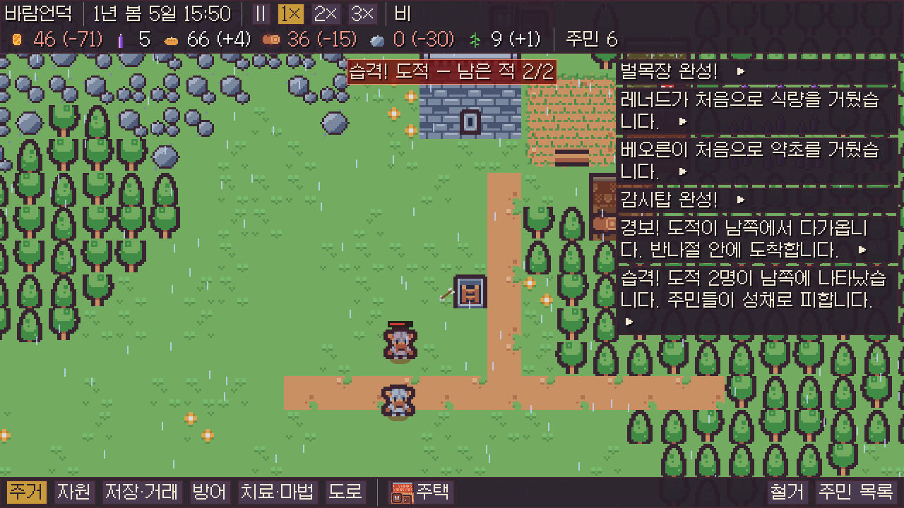
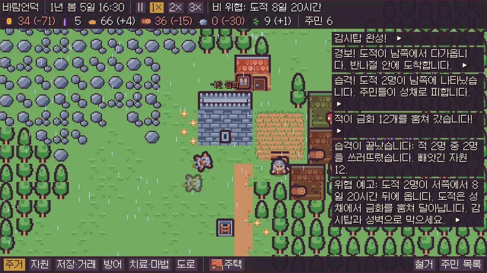
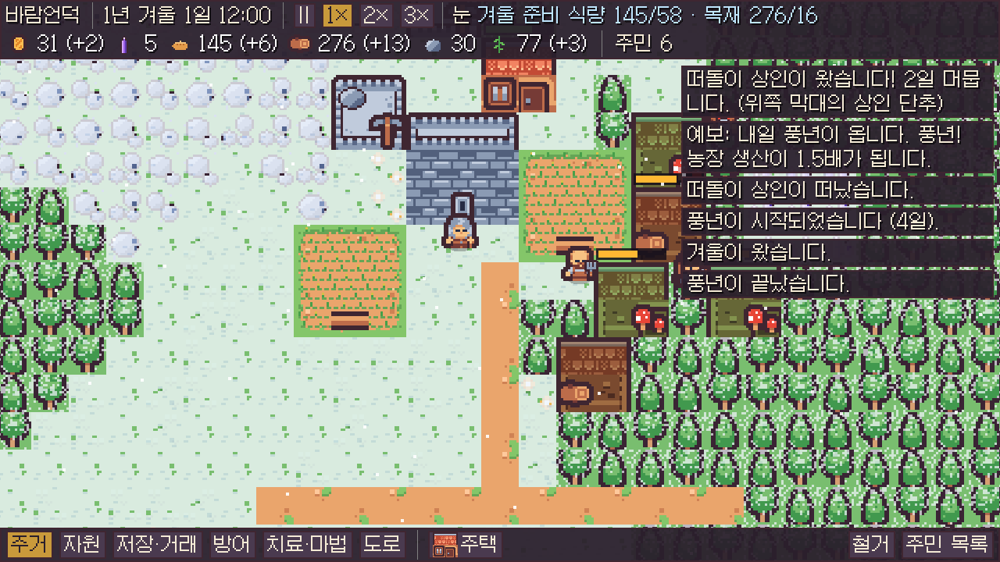
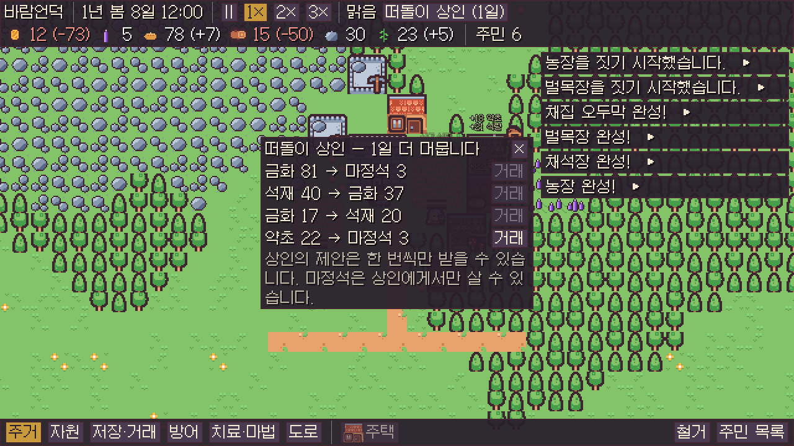
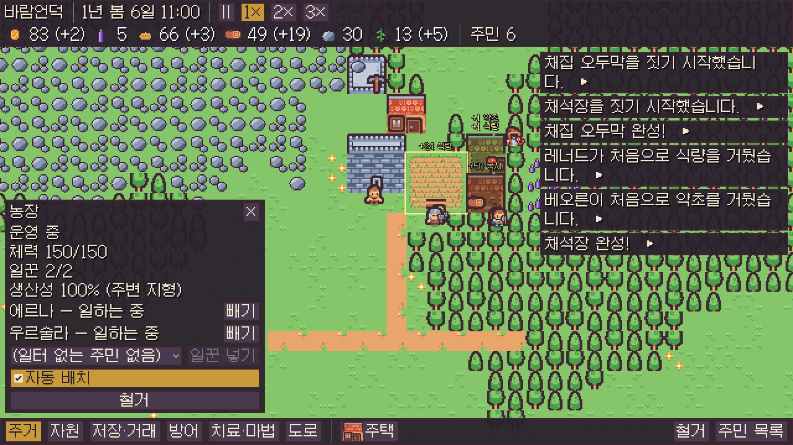

# 마법성채 키우기

폐허가 된 언덕 위 성채의 새 영주가 되어, 촌락을 왕성으로 키우는 2D 중세 판타지 경영 게임입니다.
고급프로그래밍 과제로, **게임 규칙과 상태는 C(`castle_core`)**, **화면·소리·입력은 Godot(C#)** 이 맡습니다.







> 지금은 **마일스톤 4 (위협)** 단계입니다: 마을 살림(마일스톤 2)과 계절의 압박(마일스톤 3)에 더해,
> 미리 예고되는 위협(도적·마물·적대 영주 군대), 습격(주민은 성채로 피신), 감시탑·성채 망루의 화살, 병영의 경비병, 성벽과 성문,
> 약탈과 마정석, 경보 소리. 연구와 승급은 마일스톤 5 에서 들어옵니다. 진행 상황은 [`PROGRESS.md`](PROGRESS.md)에 있습니다.

## 폴더 구조

| 위치 | 내용 |
| --- | --- |
| `core/` | C11 게임 코어 `castle_core` (공유 라이브러리). `include/castle_core.h` 가 공개 API |
| `cli/` | 콘솔판 `castle_cli`: 선생님 시연, 시뮬레이터(`--simulate`), 소크 테스트(`--soak`) |
| `tests/` | C 단위 테스트 (CTest) |
| `game/` | Godot 4.7.2 .NET 프로젝트 (`project.godot`, C# 스크립트, 장면, 에셋) |
| `game/bin/<플랫폼>/` | 빌드한 `castle_core` 가 복사되는 곳 (커밋하지 않음) |
| `cmake/` | MinGW 교차 컴파일 툴체인 파일 |
| `tools/` | 스모크 테스트·스크린숏 스크립트, 그림 생성 스크립트 |
| `docs/` | 설계 문서, C 설명서, 결정 기록, QA 체크리스트, AI 사용 기록 |
| `.github/workflows/ci.yml` | GitHub Actions CI (Linux, Windows, C#, Godot) |

## Windows 준비물 (처음 한 번)

1. **Git**
2. **Visual Studio 2022 Build Tools** (또는 Visual Studio Community) — 설치할 때 **"C++를 사용한 데스크톱 개발"** 워크로드를 고릅니다. CMake도 함께 설치됩니다.
   - MinGW-w64(gcc)를 써도 됩니다. 그때는 아래에서 `windows-msvc` 대신 `windows-mingw` 프리셋을 씁니다.
3. **CMake 3.21 이상** (Visual Studio에 들어 있는 것을 써도 됩니다. 명령 프롬프트에서 `cmake --version` 으로 확인)
4. **.NET 8 SDK** — <https://dotnet.microsoft.com/download/dotnet/8.0>
5. **Godot 4.7.2 .NET** (`Godot_v4.7.2-stable_mono_win64.zip`) — 반드시 **.NET 판**, 이 버전이어야 합니다.

## 마일스톤 브랜치 받기

```bash
git fetch origin
```

```bash
git switch <브랜치 이름>
```

브랜치 이름은 PR 페이지 위쪽에 있습니다. 이미 받아 둔 브랜치라면 `git pull` 만 하면 됩니다.

## C 코어(DLL) 빌드

저장소 맨 위 폴더에서 **"Developer PowerShell for VS 2022"** 또는 일반 명령 프롬프트를 엽니다.

```bash
cmake --preset windows-msvc
```

```bash
cmake --build --preset windows-msvc
```

빌드가 끝나면 `castle_core.dll` 이 자동으로 `game/bin/windows-x64/` 에 복사됩니다.
**게임이 실행 중이면 DLL 이 잠겨서 복사가 실패합니다.** 게임을 끄고 다시 빌드하세요.

C 테스트 실행:

```bash
ctest --preset windows-msvc
```

## 게임 실행 (Godot)

1. Godot 4.7.2 .NET 을 켜고 **가져오기(Import)** → `game/project.godot` 를 고릅니다.
2. 처음 열면 에셋을 가져오느라 잠깐 걸립니다.
3. 오른쪽 위 **빌드(망치) 버튼**으로 C# 을 빌드합니다.
4. **실행(F5)**.

DLL 을 못 찾으면 게임 화면에 "게임 코어(castle_core)를 찾을 수 없습니다" 가 나옵니다. 위의 C 코어 빌드를 먼저 하세요.

### 조작

| 입력 | 동작 |
| --- | --- |
| W A S D / 화살표 | 카메라 이동 |
| 마우스를 화면 가장자리에 | 카메라 이동 |
| 가운데 버튼 끌기 | 카메라 이동 |
| 마우스 휠, `=` / `-` | 확대 / 축소 (정수 배율) |
| 스페이스 | 일시정지 / 계속 (멈춘 채로도 짓고 고를 수 있음) |
| 1, 2, 3 | 1배속, 2배속, 3배속 |
| 아래쪽 건설 막대 | 분류 탭을 누르고 건물을 고름 (툴팁: 비용, 일자리, 못 짓는 이유) |
| 왼쪽 클릭 | 건물 놓기 (초록 미리보기일 때만) / 건물·주민 고르기 → 검사창 |
| 왼쪽 끌기 | 도로·성벽을 줄로 놓기 |
| X | 철거 도구 (비용 절반을 돌려받음) |
| V | 주민 목록 (열 제목을 누르면 정렬, 줄을 누르면 그 주민에게 이동) |
| 오른쪽 클릭 / Esc | 도구 취소, 고른 것 풀기 |
| 알림의 ▸ | 누르면 카메라가 그곳으로 |
| 위쪽 막대의 "시장" / "떠돌이 상인" | 시장 창 / 상인 창 (상인이 와 있을 때만 보임) |
| 자원 숫자에 마우스 | 저장 한도와 장부 내역 (어제 항목별, 오늘 지금까지) |

### 처음 해 볼 것
1. 농장(자원 탭)을 성채 가까이 짓고, 주택(주거 탭)을 짓습니다. 다 지어지면 놀던 주민이 알아서 일하러 갑니다.
2. 성채 문 앞에서 일터 쪽으로 도로를 끌어 놓으면 주민이 두 배 빨리 걷습니다 (걷는 시간 = 일 못 하는 시간).
3. 자원 숫자에 마우스를 올리면 저장 한도와 어제 하루 변화가 나옵니다. 식량이 줄고 있으면 농장을 더 짓습니다.
4. 빈 집이 있고 기분이 좋고 식량이 넉넉하면 아침마다 이주민이 옵니다. 굶거나 기분이 오래 나쁘면 떠납니다.
5. **가을이 되면** 위쪽 막대에 "겨울 준비 식량 …/… · 목재 …/…" 가 나옵니다. 빨가면 모자란 것이니 농장·벌목장을 늘리거나 시장(일꾼 필요)에서 사 두세요. 겨울에는 농장이 멈추고 집마다 밤에 목재 2개를 땝니다.
6. 자연 사건은 하루 전에 예보됩니다. 폭풍이 지나가면 부서진 건물(위에 체력 막대)을 눌러 "수리", 역병이 돌면 치료소에 일꾼과 약초를 준비하세요.
7. 7일째쯤 떠돌이 상인이 옵니다. 마정석은 상인에게서만 살 수 있습니다.
8. **위쪽 막대의 "위협: 도적 3일 5시간"** 은 다음 습격까지 남은 시간입니다 (마우스를 올리면 몇 명이 어느 쪽에서 오는지). 첫 습격은 5일째 13시의 작은 도적 무리입니다. 그쪽에 감시탑(방어 탭)을 지어 두세요.
9. 습격이 오면 종이 울리고 주민은 성채로 숨습니다. 감시탑과 성채 망루가 화살을 쏘고, 병영에 일꾼을 넣어 두면 경비병으로 싸웁니다. 도적은 성채·창고에서 금화를 훔쳐 달아나고, 마물(밤)은 쓰러뜨리면 마정석을 떨어뜨립니다.
10. 성벽(끌어서 줄로)과 성문으로 마을을 둘러싸면 적은 성문이나 성벽을 부숴야 들어옵니다. 주민은 성문으로 드나듭니다. 습격 중에는 수리와 저장을 할 수 없으니, 끝난 뒤에 고치세요.

## 고치고 다시 해 보기 (수정 루프)

1. **실행 중인 게임을 끕니다** (DLL 이 잠겨 있으면 다시 빌드할 수 없습니다).
2. C 를 고쳤다면 `cmake --build --preset windows-msvc` (DLL 이 `game/bin/windows-x64/` 로 복사됨).
3. C# 을 고쳤다면 Godot 의 빌드 버튼.
4. Godot 에서 실행(F5).

C 구조체(`castle_core.h`의 뷰 구조체)를 바꾸면 C# 의 `game/scripts/core/Native.cs` 도 똑같이 고치고 `CORE_ABI_VERSION` 과 `CoreBridge.ExpectedAbiVersion` 을 함께 올립니다. 어긋나면 게임이 시작할 때 알려 줍니다.

## 콘솔판 (CLI)

```bash
build/windows-msvc/bin/Release/castle_cli.exe
```

메뉴에서 번호를 골라 새 게임, 상태 보기, 지도 보기, 시간 진행, 건물 짓기·줄 놓기·철거, 주민·건물 목록, 일꾼 배치, 저장/불러오기를 합니다.
건물·특성·이름 정의는 `game/data/` 에서 읽습니다 (저장소 맨 위 폴더에서 실행하거나 `--data <폴더>` 로 알려 줌).

```bash
build/windows-msvc/bin/Release/castle_cli.exe --simulate 30 --seed 7 --out sim.csv
```

```bash
build/windows-msvc/bin/Release/castle_cli.exe --soak 100 --seeds 5
```

`--simulate` 는 하루마다 자원·인구를 CSV 로 씁니다 (밸런스 조정용, `--bot reasonable` 은 알아서 짓는 봇, `--events` 는 알림도 출력). `--soak` 는 무작위 명령을 섞어 오래 돌리며 매 틱 불변 조건을 검사합니다.

### 정의 파일 고치기 (밸런스)
`game/data/buildings.def` 의 숫자(비용, 일꾼 수, 생산량, 임금 …)를 바꾸면 게임과 CLI 가 다음 실행부터 그 값을 씁니다. 틀린 줄이 있으면 그 파일은 기본값을 쓰고 "몇 번째 줄" 경고를 보여 줍니다. 처음 값으로 되돌리려면 `castle_cli --dump-defs game/data`.

## Linux / 클라우드 세션 명령

```bash
cmake --preset linux-debug && cmake --build --preset linux-debug && ctest --preset linux-debug
```

```bash
tools/smoke_test.sh 20
```

```bash
tools/screenshots.sh
```

전체 명령 목록은 [`CLAUDE.md`](CLAUDE.md) 의 Commands 절에 있습니다.

## 문서

- [`docs/SPEC.md`](docs/SPEC.md) — 전체 설계 명세 (영어)
- [`docs/ARCHITECTURE.md`](docs/ARCHITECTURE.md) — 구조, 소유권, 두 가지 핸드셰이크, API 목록
- [`docs/C_REQUIREMENTS.md`](docs/C_REQUIREMENTS.md) — 과제 C 요구사항 ↔ 코드 위치 ↔ 게임 기능
- [`docs/C_WALKTHROUGH.md`](docs/C_WALKTHROUGH.md) — C 모듈별 설명과 예상 질문
- [`docs/DECISIONS.md`](docs/DECISIONS.md) — 설계 결정과 이유
- [`docs/QA.md`](docs/QA.md) — 수동 QA 체크리스트
- [`docs/AI_USAGE.md`](docs/AI_USAGE.md) — 생성형 AI 사용 기록
- [`docs/devlog/TEMPLATE.md`](docs/devlog/TEMPLATE.md) — 개발 일지 양식
- [`CREDITS.md`](CREDITS.md) — 에셋 출처와 라이선스
