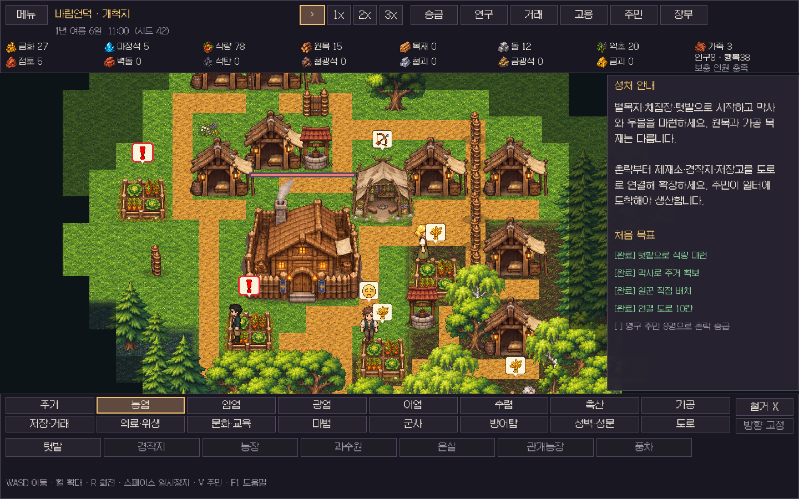
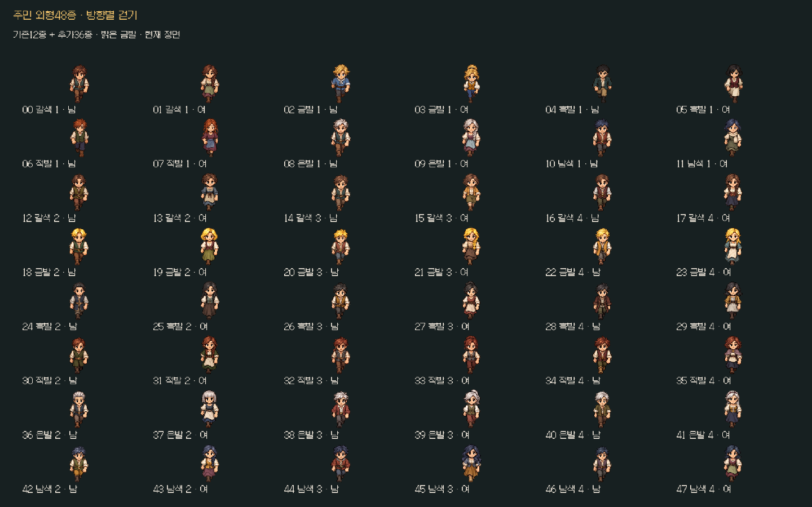
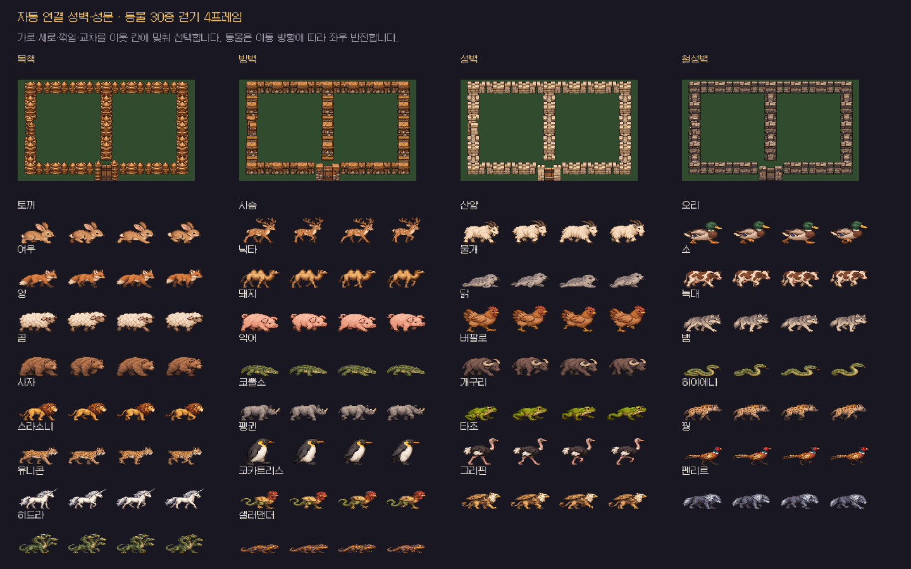
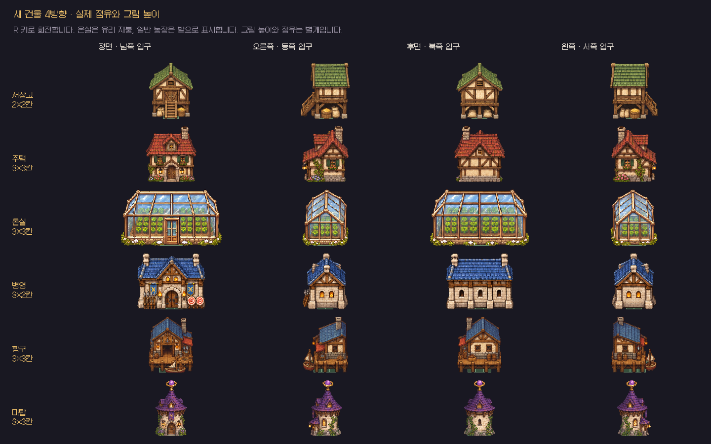

# 마법성채 키우기

현재 버전은 **v1.2.2**입니다. [변경 명세](docs/V1_2_2_SPEC.md)와 학생의 추가 요청을 적용합니다.
변경 규칙은 [적용 기록](docs/V1_2_2_IMPLEMENTATION.md), 실제 검사 결과와 미달 목표는 [검증 기록](docs/V1_2_2_QA.md)에 있습니다.
행복도와 사건 기분을 분리하고, 일반 이주·인구 하한·저장 허브·10개 생물군계·수역 온도·30종 동물·거래 시세를 적용했습니다.
시작 건물은 회전하지 않는 4×4 영주관이며 등급별 그림 6개와 하루 승급 공사를 사용합니다.
도로는 바닥 테두리를 남기며8방향으로 연결됩니다. 건물 높이는 점유 칸을 지키며 원본 비율에 맞춥니다. 수목20개 잘림을 교정했고 온수·냉수 물가 연결과 동물 수영·공격·피격·사망을 표시합니다.
합류 전과 이탈 중 주민은 어두운 공간에서도 보이지만 시야를 밝히지 않습니다.

개척지를 촌락·마을·도시·성채·왕성으로 성장시키는 2D 중세 판타지 경영 게임입니다.
**게임 규칙·화면·입력·이동·전투·메뉴·저장을 C로 구현**하며 그래픽·창·소리는 raylib 5.5를 사용합니다.
Godot, .NET, C#, Python 설치는 필요하지 않습니다.

주민·적·건물·수목·광석·지면·도로·자원 아이콘을 새 중세 판타지 픽셀아트로 제작했습니다.
건물은 지붕을 내려다보는 약45도 구도이며 주민은 머리색별 남녀48외형과 정면·측면·뒷면 걷기를 제공합니다. 이름의 성별과 외형을 연결하며 직업을 바꿔도 유지됩니다. 출동 중에는 야영지·수렵기지·병영·군영 업무복과 방향별 공격을 표시합니다. 금발은 밝은 노랑이며 앞/뒤 활은 해당 방향으로 쏩니다.
주민은 1×1칸 판정에 약 1.5칸 높이이며, 높은 건물과 수관은 뒤의 칸과 주민을 가립니다.
점유 칸과 그림 높이·앞뒤 정렬 설명, 원본과 C 패킹 방법은 [art/README.md](art/README.md)입니다.

통합 확장: 192×192 지도, 15자원, 건설65종과 시작 영주관, 연구 24종을 제공합니다.
일반 건물은 정면·후면·양옆 그림으로 회전합니다. 경작지·농장·관개농장은 계절별 밀밭, 과수원은 울타리와 과일나무, 온실은 유리 지붕을 표시합니다. 성벽과 영주관은 회전하지 않습니다.
주민은 지붕이 있는 건물 안으로 들어갑니다. 무인 시설의 빨간 느낌표, 주민 욕구와 건물 작업 아이콘이 말풍선으로 표시됩니다.
규칙과 문서 충돌의 해석은 [확장 구현 기록](docs/expansion/IMPLEMENTATION.md), 장기 검사 결과는 [확장 QA](docs/expansion/QA_RESULTS.md)에 기록합니다.

성벽은 주변 벽·문에 맞춰 가로·세로·모서리가 자동 연결됩니다. 동물 30종에는 옆모습 4프레임 걷기를 적용했습니다.
보호구역 안에서는 주민의 안전 욕구가 회복되고, 위험 시 걸어갈 수 있는 가까운 보호구역으로 대피합니다. 성문 철거에도 도로 연결 검사를 적용합니다.
개척지에는 5~8일과 10~13일에 각각 2명이 조건 없이 한 번씩 이주합니다. 두 번째 합류 이후 3일마다 1명씩 영구 인구 8명까지 보충합니다.







## Windows 빌드와 실행

배포 ZIP을 받은 경우 압축을 풀고 `MagicCastle-v1.2.2/castle_game.exe`를 실행하면 됩니다. `assets/`와 `data/` 폴더도 함께 두세요.
아래 도구 설치는 직접 소스를 빌드할 때 필요합니다.

준비물: CMake 3.21 이상과 Visual Studio 2022 C/C++ 개발 도구 또는 MinGW-w64 + Ninja.
첫 그래픽 빌드 때 공식 raylib 소스를 내려받습니다. 버전과 SHA-256을 고정했으며 다음부터 빌드 캐시를 사용합니다.

Visual Studio 개발자 터미널:

```powershell
cmake --preset windows-msvc -DCASTLE_WERROR=ON
cmake --build --preset windows-msvc
ctest --preset windows-msvc
./build/windows-msvc/bin/Release/castle_game.exe
```

MinGW/Ninja의 일부 배포판은 한글 프로젝트 경로를 처리하지 못합니다. 이때 PowerShell에서:

```powershell
./tools/build_windows.ps1
```

이 스크립트는 비어 있는 드라이브 문자를 프로젝트에 잠시 연결해 구성·빌드·테스트하고 연결을 해제합니다.
완료 메시지의 폴더에서 `castle_game.exe`를 실행하세요. `data/`, `assets/`도 함께 복사됩니다.
영문 경로에서는 `windows-mingw` 프리셋도 바로 사용할 수 있습니다.

## Linux 빌드

그래픽 빌드에는 C/C++ 빌드 도구, CMake, Ninja, OpenGL·X11 개발 패키지가 필요합니다.
Ubuntu 패키지: `build-essential ninja-build libgl1-mesa-dev libx11-dev libxrandr-dev libxi-dev libxcursor-dev libxinerama-dev`.

```sh
cmake --preset linux-release -DCASTLE_WERROR=ON
cmake --build --preset linux-release
build/linux-release/bin/castle_game
```

그래픽 장치·raylib 없이 C 코어와 이동·전투만 검사:

```sh
cmake --preset linux-debug -DCASTLE_WERROR=ON
cmake --build --preset linux-debug
ctest --preset linux-debug -j8
```

## 조작

| 입력 | 동작 |
| --- | --- |
| WASD / 화살표 | 카메라 이동 |
| 가운데 버튼 끌기 / 휠 | 이동 / 정수 배율 확대 |
| 스페이스 / 1·2·3 | 일시정지 / 배속 |
| 아래쪽 건설 분류·건물 버튼 | 건설 도구 선택 |
| 왼쪽 클릭 / 도로·성벽 드래그 | 건설·선택 / 줄 놓기 |
| 오른쪽 클릭 / X | 도구 취소 / 철거 |
| R | 건설 미리보기 또는 선택한 건물 회전 |
| V / F1 | 주민 목록 / 도움말 |
| Esc | 열린 창 → 도구 → 선택 순으로 닫고 메뉴 |

막사·텃밭·채집장·벌목지와 우물을 마련하세요. 원목과 가공 목재는 별개이며, 제재소에서 목재를 만듭니다.
일터에 도착해 실제로 일한 시간만 생산에 반영됩니다. 경작지·농장은 봄·여름 노동을 모아 25일째 오전 8시에 한 번 수확합니다.
1년은 48일, 계절은 12일, 보통 배속의 하루는 120초입니다. 겨울 식량과 석탄·원목·목재 연료를 비축하세요.
촌락부터 새 시설 입구는 성채 입구와 이어진 도로에 붙여야 합니다. 적은 실제 시야에 들어왔을 때 경보가 울립니다.
성벽으로 주거를 감싸고 경비병과 방어탑에 일꾼을 배치하세요. 마탑 이전에도 도시의 도서관·마법 공방에서 기초 연구를 시작할 수 있습니다.

주민·건물 검사창, 직접 일꾼 배치, 거래·상인, 연구, 승급, 장부, 정렬 가능한 주민 목록,
초반 목표·승패 화면, 이름·시드·난이도, 설정·슬롯 메뉴를 제공합니다.
이름 입력은 완성 문자와 Ctrl+V 한글 붙여넣기를 지원합니다.

## 저장과 배포

- Windows: `%APPDATA%/MagicCastle/saves_v10/`, 설정은 상위 폴더의 `settings.cfg`.
- Linux: `$XDG_DATA_HOME/magic-castle/` 또는 `~/.local/share/magic-castle/`.
- 불러오기 화면의 v9 가져오기는 원본을 보존하고 빈 v10 수동 슬롯으로 변환합니다.
- 자동 저장과 슬롯 1~3, 원자적 저장과 `.bak` 복구. 현재 세이브 v10·API ABI12.
- 습격 중에는 저장·수리를 막으며 자동 저장을 습격 종료 뒤로 미룹니다.
- 자동 검사는 실행 파일 옆 `saves_v10_automated/` 또는 지정한 `--save-dir`를 사용합니다.
- v8 이하 저장은 호환되지 않습니다. 이전 저장 폴더의 파일은 지우거나 덮어쓰지 않으며 새 게임을 시작해야 합니다.
- 실행 파일·`data/`·`assets/`·라이선스를 함께 배포합니다. 별도 코어 DLL은 필요하지 않습니다.

## 검사와 C 도구

아래 실행 파일 경로는 Visual Studio 빌드 기준입니다. 다른 빌드의 bin 폴더도 같은 이름을 사용합니다.

```powershell
# 창 없이 실제 C 이동·전투로 20일 자동 플레이하고 저장 해시 검사
./build/windows-msvc/bin/Release/castle_game.exe --smoke-test --days 20 --seed 42

# 주민 150명 + 기본 적 40명·소환체 + 야생 360마리·새끼 60마리 (420 야생은 과부하 검사)
./build/windows-msvc/bin/Release/castle_game.exe --stress
./build/windows-msvc/bin/Release/castle_game.exe --stress-probe --no-audio
./build/windows-msvc/bin/Release/castle_game.exe --stress-probe --stress-animals 420 --no-audio

# Python 대신 C로 구현한 밸런스 집계
./build/windows-msvc/bin/Release/castle_balance.exe --seeds 16 --days 100

# 현재 확장 규칙: 실제 이동·전투, 일별 CSV와 저장 왕복
./build/windows-msvc/bin/Release/castle_expansion_balance.exe --days 200 --seeds 48 --out artifacts/expansion/quality-final

# C 콘솔판과 장시간 검사
./build/windows-msvc/bin/Release/castle_cli.exe
./build/windows-msvc/bin/Release/castle_cli.exe --soak 400 --seeds 20

# 전체 원화 재패킹은 기본 확장판 → v1.1.1 → v1.2.1 → v1.2.2 순서
./build/windows-msvc/bin/Release/castle_expansion_art.exe art/expansion game/assets/expansion
./build/windows-msvc/bin/Release/castle_v111_art.exe art/v111 game/assets/expansion
./build/windows-msvc/bin/Release/castle_v111_art.exe --check game/assets/expansion
./build/windows-msvc/bin/Release/castle_v121_art.exe art/v121 game/assets/expansion
./build/windows-msvc/bin/Release/castle_v121_art.exe --check game/assets/expansion
./build/windows-msvc/bin/Release/castle_v122_art.exe
./build/windows-msvc/bin/Release/castle_v122_art.exe --check game/assets/expansion
```

`castle_game --screenshot <파일.png> --screen title|game|villagers|uniforms|farms|rotations|connections|population|research|rank|market|load --no-audio`로 화면을 촬영합니다. `tools/screenshots_v122.ps1`은 두 해상도의 검사용 화면을 만듭니다.
`tools/screenshots.cmake`, `tools/smoke_test.cmake`로도 실행할 수 있습니다.
각 실행 파일은 `--help`를 제공합니다.

현재 버전의 전체 검사·실제 v9 이관·100시드 지도·장기 평가·성능 결과는 [v1.2.2 검증 기록](docs/V1_2_2_QA.md)에 기록합니다. 이전 버전의 수치는 해당 버전 QA 문서에 보존합니다.

## 구조

| 위치 | 역할 |
| --- | --- |
| core/ | C11 상태·게임 규칙·정의·저장·검증 |
| core/src/expansion_*.c | 현재 확장 카탈로그·지도·생산·생활·동물·시장·연구·저장 |
| game/src/session.c | 뷰 동기화·고정 틱·주민 이동 |
| game/src/path.c | 가중치 격자 A* |
| game/src/combat.c | 적·경비병·탑·투사체·결과 보고 |
| game/src/main.c | 한 판의 흐름·자동 저장·자동 검사 |
| game/src/render.c, panels.c, ui.c | 지도·카메라·건설·한국어 UI |
| game/src/assets.c, storage.c | PNG·TTF·OGG·한글 경로·설정 |
| game/data/, game/assets/ | 기존 정의와 CC0/OFL 리소스 |
| cli/ | 콘솔판·공용 C 봇·CSV·간이 전투·소크 |
| tools/balance.c | C 밸런스 결과 집계 |
| tools/expansion_balance.c, pack_expansion_art.c | 확장 장기 검사·65종 회전 그림 패킹 |
| tests/ | 코어·CLI·새 실행 계층 검사 |
| docs/ | 구조·전환 범위·발표·QA·AI 기록 |

전환 범위와 간소화는 [NATIVE_PORT.md](docs/NATIVE_PORT.md), 검증 결과는 [PROGRESS.md](PROGRESS.md)를 보세요.
원본 PNG를 유지하고 Python 그림 재생성기는 제거했습니다. 같은 이름의 PNG를 교체해 그림을 바꿀 수 있습니다.
