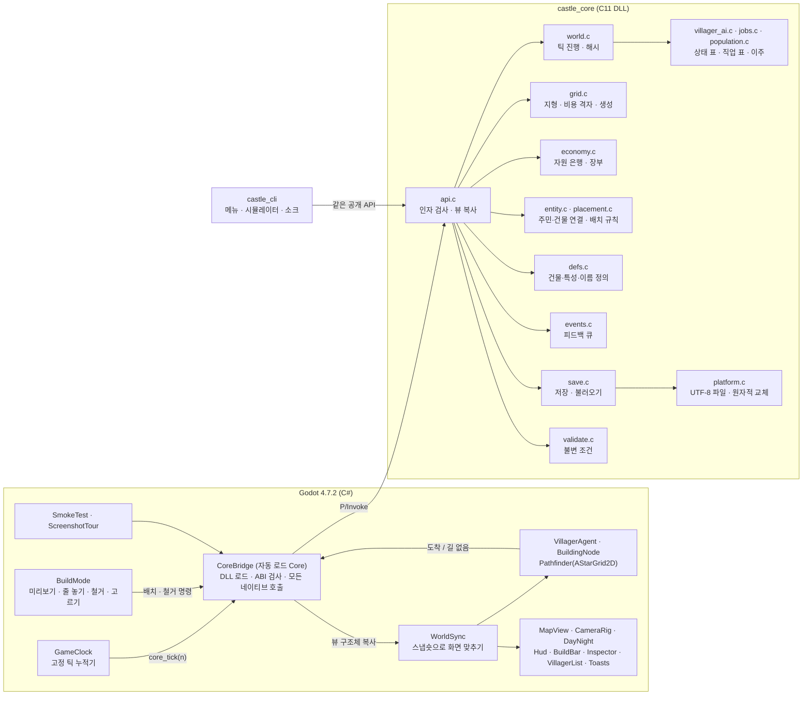

# 구조 (ARCHITECTURE)

> 원칙: **C 는 마을에 대한 진실을 가진다. Godot 은 공간과 감각을 맡는다.**

## 그림



## 누가 무엇을 가지는가

| C 코어 (`castle_core`) | Godot (C#) |
| --- | --- |
| **저장되는 모든 상태**: 주민, 건물, 자원과 장부, 지도(지형·점유·이동 비용), 계절·날씨, 연구, 시장 가격, 위협 일정, 등급, 난수 상태 | **공간과 실시간의 모든 것**: 움직이는 유닛의 연속 위치, 길찾기(`AStarGrid2D`), 적 유닛과 전투 계산, 투사체, 카메라, 입력, 그림, 애니메이션, 조명, 파티클, 소리, UI, 메뉴 |
| **모든 규칙과 수치**: 생산, 소비, 임금, 저장 한도, 기분, 병, 이주, 배치 검사, 비용, 연구 효과, 사건 일정, 습격 구성, 등급 조건, 승패, 적·탑의 능력치 | **물리적 사실을 C 에 보고**: 주민 도착 / 길 없음, 건물·주민 피해, 적 처치, 약탈, 습격 끝 |
| 위 모든 것의 저장·불러오기 | 설정 파일만 (음량, 해상도, UI 배율) |

마일스톤 2 까지 실제로 있는 것: 지도(지형, 도로, 점유, 비용 격자), 시계, 난수, 자원 은행과 장부, 건물·특성·이름 정의 파일, 주민과 건물(양방향 연결), 배치·건설·철거, 생산·소비·임금·세금, 기분, 이주와 떠남, 피드백 이벤트, 저장·불러오기, 불변 조건 검사.

## 경계 규칙 (안정성의 핵심)

1. Godot 은 게임 상태를 직접 바꾸지 않습니다. 모든 변경은 C 명령이나 보고를 거치고, C 가 매번 검사합니다.
2. **불투명 핸들, 평평한 뷰**: Godot 은 월드를 `IntPtr` 하나로만 들고 있습니다. 데이터는 `int32_t` 필드와 고정 크기 UTF-8 배열로 된 뷰 구조체에 복사되어 건너옵니다. C 메모리를 가리키는 포인터는 보관하지 않습니다.
3. **이벤트가 아니라 스냅숏으로 맞추기**: 매 틱 뒤, 그리고 명령이 성공한 직후(일시정지 중에도) `WorldSync` 가 요약과 주민·건물 뷰 전체를 복사해 id 로 노드를 만들고·고치고·지웁니다. 이벤트 큐는 소리·알림·떠오르는 숫자에만 씁니다. 이벤트를 놓쳐도 어긋나지 않습니다.
4. **id 는 다시 쓰지 않습니다** (주민·건물 각각 단조 증가 32비트 카운터, 저장됨). 철거된 건물의 늦은 보고는 `CORE_ERR_NOT_FOUND` 로 안전하게 버려집니다.
5. **코어는 언어를 모릅니다**: C 는 이벤트 코드와 숫자만 냅니다. 한국어 문장은 Godot 의 `Strings.cs` 와 CLI 의 `format.c` 가 만듭니다.
6. **고정 틱, 결정적 코어**: 1틱 = 게임 속 10분 (하루 144틱). Godot 은 실제 시간 × 배속을 모아 `core_tick(world, n)` 을 정수로 부릅니다. 난수(PCG32)는 월드 안에 있고 저장됩니다. 같은 시드 + 같은 명령 순서 → 같은 상태 (테스트 `world_same_seed_same_state`).
7. **한 스레드**: 코어는 Godot 메인 스레드에서만 부릅니다. 에디터(`[Tool]`)는 DLL 을 로드하지 않습니다 (`Engine.IsEditorHint()` 검사).
8. **시작할 때 ABI 검사**: `core_abi_version()` 과 C 가 알려 주는 구조체 크기를 `Marshal.SizeOf<T>()` 와 비교하고, 다르면 분명한 메시지를 띄우고 시작하지 않습니다.
9. **우아하게 실패**: 모든 C API 함수는 인자를 검사하고 오류 코드를 돌려줍니다. Godot 은 `CoreBridge` 한 곳에서 모든 호출을 감싸 `CoreResult` 로 바꿉니다.

## 주민 핸드셰이크 (마일스톤 2)

1. C 가 매 틱 주민마다 상태 기계를 돌립니다. 상태 번호로 함수를 고르는 표 `villager_ai.c:STATE_TABLE[]`: `IDLE`, `SLEEP`, `GO_WORK`, `WORKING`, `EAT`, `SEEK_HEALING`, `FLEE`, `GUARD_POST`, `LEAVING` (뒤의 셋은 마일스톤 3~4).
2. 주민은 **의도**(상태, 목표 건물 또는 칸, `intentRev`, 깃발 `HOLD`/`SPAWN_EDGE`)를 내보냅니다. 의도가 바뀔 때마다 `intentRev` 가 1 오릅니다.
3. Godot(`VillagerAgent`)이 `AStarGrid2D` 로 길을 찾아 걷게 하고, 도착하면 `core_villager_arrived(world, id, intentRev)` 를 부릅니다. C 는 오래된 rev 를 `CORE_IGNORED` 로 무시합니다.
4. 길이 없으면 `core_villager_unreachable(...)`. C 는 그 자리에서 3시간(18틱) 기다리게 하고(`HOLD`), "길이 막혔습니다" 알림을 주민마다 하루 한 번 냅니다.
5. **C 쪽 안전장치**: 하루(144틱) 안에 보고가 없으면 길이 없는 것으로 칩니다. Godot 이 멈추거나 보고를 빠뜨려도 주민이 영원히 걷지 않습니다.
6. 생산은 `WORKING` 일 때만 쌓입니다. 그래서 **걷는 시간 = 일 못 하는 시간**이고, 집·일터 배치와 도로(걷기 2.5배 빠름)가 중요해집니다.
7. 걷는 속도는 C 가 정해 뷰에 담습니다(`walk_milli_tiles_per_tick`). Godot 은 그 속도 × 칸 비용으로 걷기만 합니다.
8. CLI 와 소크 테스트에서는 `cli/walker.c` 가 같은 일을 합니다 (다익스트라로 걸리는 틱 수를 계산해 그만큼 뒤에 도착 보고).
9. 불러온 뒤에는 C 가 저장한 위치(`loc_x`, `loc_y`)에서 다시 나타나고, 걷던 주민은 같은 의도로 다시 걷기 시작합니다.

## 건물 배치 (마일스톤 2)

- 미리보기와 실제 배치가 **같은 함수**(`placement.c:placement_check`)를 씁니다. 그래서 초록 미리보기면 반드시 지어집니다.
- 규칙: 지도 안, 가장자리 여백, 지형(물·광맥 위 불가, 숲은 베어 냄), 겹침, 다른 건물의 문 앞 칸, 자기 문 앞 칸, 숲 근처·바위 옆·광맥 위 규칙, 등급, **길이 끊기지 않을 것**(성채 문에서 닿던 문과 지도 가장자리에 계속 닿고, 새 문에도 닿아야 함), 비용.
- 길 검사는 먼저 빠른 검사를 합니다: 발자국을 둘러싼 테두리에서 걸을 수 있는 칸이 한 덩어리면 끊길 곳이 없으므로 새 문까지만 찾습니다. 아니면 지도 전체를 두 번 채워 봅니다.
- 건물이 다 지어지면 비용 격자가 바뀌고 `cost_grid_rev` 가 오릅니다. Godot 은 rev 가 바뀔 때만 길찾기 격자와 도로 층을 다시 만듭니다.

## 습격 핸드셰이크 (마일스톤 4 에서 구현)

1. C 가 위협을 미리 정하고 `THREAT_SCHEDULED`(종류, 방향, 도착 시각, 세기)를 냅니다. UI 는 남은 시간을 보여 줍니다.
2. 도착하면 C 가 습격(id, 적 종류 × 수)을 만듭니다. 적 능력치는 C 의 정의 파일에서 옵니다.
3. Godot 이 지도 가장자리에 유닛을 만들고 전투를 돌립니다.
4. Godot 이 피해, 처치, 약탈, 습격 끝을 보고합니다.
5. C 가 체력, 죽음, 무너진 건물, 보상(마물 → 마정석), 안전 기분을 처리합니다.
6. 전투는 물리 엔진 없이 단순하게: `AStarGrid2D` 경로, 성벽은 비싼 칸, 탑·경비병은 사거리 안 가장 가까운 적을 쿨다운마다 공격.
7. 습격 중에는 저장할 수 없습니다.

## 시간의 흐름 (마일스톤 1)

```
매 프레임:  GameClock._Process(delta)
             누적 += delta × 배속
             n = floor(누적 / 0.5초)   (0.5초 = 1배속의 한 틱, C 의 real_ms_per_tick)
             n > 0 이면 Core.Tick(n) → core_tick(world, n)
                          → Ticked 신호 → WorldSync.Reconcile()
                                           ├ core_get_summary → HUD
                                           ├ cost_grid_rev 확인 (길찾기 다시 만들기, M2)
                                           └ core_poll_event 반복 → 알림
             DayNight 는 매 프레임 (분 + 틱 진행률) 로 색을 부드럽게 계산
```

## 공개 API (`core/include/castle_core.h`, ABI 2)

| 분류 | 함수 | 하는 일 |
| --- | --- | --- |
| 버전 | `core_abi_version()` | ABI 번호 (지금 2) |
| | `core_get_struct_sizes(out, size)` | 뷰 구조체 크기 (C# 이 비교) |
| | `core_get_config(out)` | 하루 틱 수, 실제 시간, 밤·근무 시각 등 고정값 |
| | `core_result_name(code)` | 오류 코드의 영어 이름 (로그용) |
| 정의 | `core_defs_create(&defs)` / `core_defs_destroy` | 내장 기본값으로 정의 묶음 만들기 |
| | `core_defs_load_text(defs, file_id, text, &line)` | 정의 파일 내용 읽기 (Godot 은 `FileAccess` 로 읽어서 넘김) |
| | `core_defs_load_file` / `core_defs_save_file` | 파일에서 읽기 / 기본값을 파일로 쓰기 (CLI) |
| 수명 | `core_create(params, defs, &world)` | 새 게임 (성채 이름, 시드, 난이도, 정의) |
| | `core_destroy(world)` | 해제 (NULL 이어도 됨) |
| 시간 | `core_tick(world, n)` | n 틱 진행 (1 ≤ n ≤ 1440) |
| 읽기 | `core_get_summary(world, out)` | 날짜·시각·자원(한도, 어제 변화)·인구·성채 위치 등 |
| | `core_get_map_size`, `core_copy_terrain`, `core_copy_roads` | 지도 크기, 지형, 도로 |
| | `core_copy_cost_grid(world, buf, cap, &rev)` | 이동 비용 격자 + 수정 번호 |
| | `core_copy_villagers`, `core_copy_buildings` | 주민·건물 뷰 전체 (버퍼가 작으면 필요한 개수를 알려 줌) |
| | `core_get_building_def`, `core_get_trait_def`, `core_get_mood_terms` | 건물·특성 정의, 주민 기분의 항목별 이유 |
| 배치 | `core_can_place(world, type, x, y, out)` | 미리보기: 결과 이유, 문 앞 칸, 생산성 |
| 명령 | `core_place_building`, `core_place_line`, `core_demolish`, `core_remove_road` | 짓기, 줄 놓기(도로·성벽), 철거(절반 환불) |
| | `core_assign_worker`, `core_unassign_worker`, `core_release_worker`, `core_set_auto_assign` | 일꾼 직접 배치·빼기·자동에 맡기기, 건물별 자동 배치 |
| 보고 | `core_villager_arrived`, `core_villager_unreachable` | 주민 핸드셰이크 |
| 피드백 | `core_poll_event(world, out)` | 이벤트 하나 꺼내기 (있으면 1) |
| 저장 | `core_save(world, path)` | 원자적 저장 + `.bak` |
| | `core_load(path, defs, &world, &line)` | 불러오기, 실패하면 문제 줄 번호 |
| 디버그 | `core_validate(world)` | 불변 조건 위반 개수 |
| | `core_state_hash(world, &hash)` | 저장되는 상태 전체의 해시 |

다음 마일스톤에서 더해질 것: 수리, 거래, 연구, 승급 명령, 습격 보고(피해, 처치, 약탈, 습격 끝), 위협 뷰.

## 결과 코드

| 코드 | 값 | 뜻 |
| --- | --- | --- |
| `CORE_OK` | 0 | 성공 |
| `CORE_ERR_NULL_ARG` | -1 | 꼭 필요한 포인터가 NULL |
| `CORE_ERR_INVALID_ARG` | -2 | 값의 범위가 잘못됨 |
| `CORE_ERR_OUT_OF_MEMORY` | -3 | 할당 실패 (기존 상태는 그대로) |
| `CORE_ERR_BUFFER_TOO_SMALL` | -4 | 호출한 쪽 버퍼가 작음 |
| `CORE_ERR_FILE_OPEN` | -5 | 파일을 열 수 없음 |
| `CORE_ERR_FILE_IO` | -6 | 읽기·쓰기·교체 실패 |
| `CORE_ERR_FORMAT` | -7 | 세이브·정의 파일 내용이 잘못됨 |
| `CORE_ERR_VERSION` | -8 | 세이브 파일 버전이 다름 |
| `CORE_ERR_STRUCT_SIZE` | -9 | ABI 검사: 구조체 크기가 다름 |
| `CORE_ERR_REJECTED` | -10 | 게임 규칙상 할 수 없음 (이유는 `out_reason`, 예: 자원 부족, 길을 막음) |
| `CORE_ERR_NOT_FOUND` | -11 | 그런 id 의 주민·건물이 없음 |
| `CORE_IGNORED` | 1 | 오류는 아니지만 무시함 (오래된 `intentRev` 보고) |
