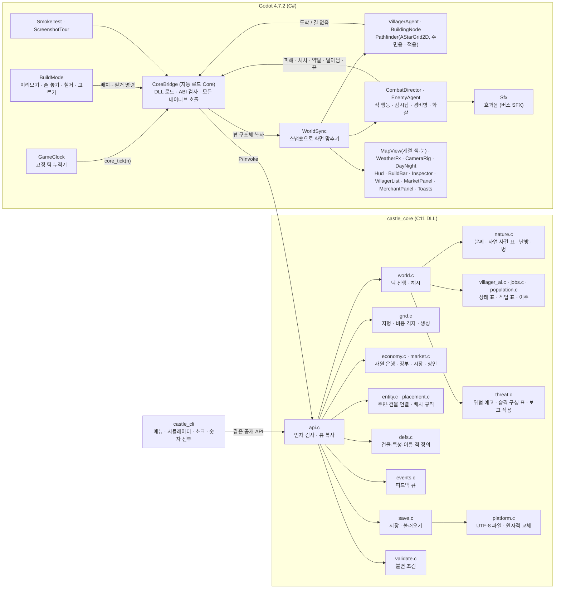
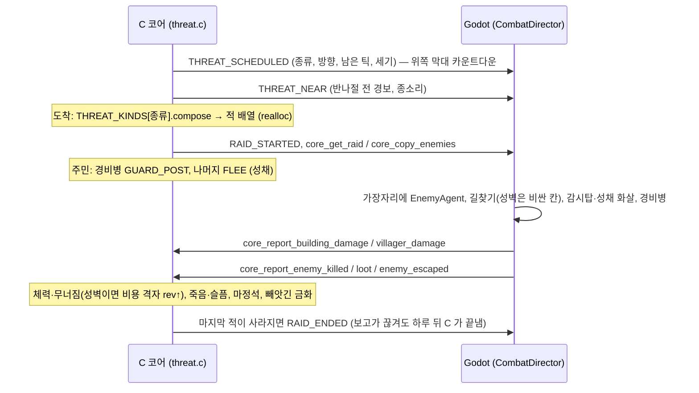

# 구조 (ARCHITECTURE)

> 원칙: **C 는 마을에 대한 진실을 가진다. Godot 은 공간과 감각을 맡는다.**

## 그림



## 누가 무엇을 가지는가

| C 코어 (`castle_core`) | Godot (C#) |
| --- | --- |
| **저장되는 모든 상태**: 주민, 건물, 자원과 장부, 지도(지형·점유·이동 비용), 계절·날씨, 연구, 시장 가격, 위협 일정, 등급, 난수 상태 | **공간과 실시간의 모든 것**: 움직이는 유닛의 연속 위치, 길찾기(`AStarGrid2D`), 적 유닛과 전투 계산, 투사체, 카메라, 입력, 그림, 애니메이션, 조명, 파티클, 소리, UI, 메뉴 |
| **모든 규칙과 수치**: 생산, 소비, 임금, 저장 한도, 기분, 병, 이주, 배치 검사, 비용, 연구 효과, 사건 일정, 습격 구성, 등급 조건, 승패, 적·탑의 능력치 | **물리적 사실을 C 에 보고**: 주민 도착 / 길 없음, 건물·주민 피해, 적 처치, 약탈, 습격 끝 |
| 위 모든 것의 저장·불러오기 | 설정 파일만 (음량, 해상도, UI 배율) |

마일스톤 4 까지 실제로 있는 것: 지도(지형, 도로, 점유, 비용 격자), 시계, 난수, 자원 은행과 장부, 건물·특성·이름·적 정의 파일, 주민과 건물(양방향 연결), 배치·건설·철거·피해·수리, 생산·소비·임금·세금·난방, 기분, 병과 치료, 이주와 떠남, 날씨와 자연 사건(예보), 시장과 떠돌이 상인, 위협 예고와 습격(피신·경비, 보고 적용), 피드백 이벤트, 저장·불러오기, 불변 조건 검사.

전투에서 Godot 쪽에 있는 상수(적이 성벽을 돌아가는 기준인 성벽 칸 비용 12배, 마물의 시야 8칸, 경비병이 병영에서 쫓아가는 거리 8칸, 목표를 다시 고르는 30분, 화살 속도)는 **규칙이 아니라 "싸움을 어떻게 풀고 보여 줄지"** 입니다. 피해·체력·거리·공격 사이·속도 같은 수치는 모두 C 의 정의에서 읽습니다.

## 경계 규칙 (안정성의 핵심)

1. Godot 은 게임 상태를 직접 바꾸지 않습니다. 모든 변경은 C 명령이나 보고를 거치고, C 가 매번 검사합니다.
2. **불투명 핸들, 평평한 뷰**: Godot 은 월드를 `IntPtr` 하나로만 들고 있습니다. 데이터는 `int32_t` 필드와 고정 크기 UTF-8 배열로 된 뷰 구조체에 복사되어 건너옵니다. C 메모리를 가리키는 포인터는 보관하지 않습니다.
3. **이벤트가 아니라 스냅숏으로 맞추기**: 매 틱 뒤, 그리고 명령이 성공한 직후(일시정지 중에도) `WorldSync` 가 요약과 주민·건물 뷰 전체를 복사해 id 로 노드를 만들고·고치고·지웁니다(적은 `CombatDirector` 가 습격·적 뷰로 같은 방식). 이벤트 큐는 소리·알림·떠오르는 숫자에만 씁니다. 이벤트를 놓쳐도 어긋나지 않습니다.
4. **id 는 다시 쓰지 않습니다** (주민·건물 각각 단조 증가 32비트 카운터, 저장됨). 철거된 건물의 늦은 보고는 `CORE_ERR_NOT_FOUND` 로 안전하게 버려집니다.
5. **코어는 언어를 모릅니다**: C 는 이벤트 코드와 숫자만 냅니다. 한국어 문장은 Godot 의 `Strings.cs` 와 CLI 의 `format.c` 가 만듭니다.
6. **고정 틱, 결정적 코어**: 1틱 = 게임 속 10분 (하루 144틱). Godot 은 실제 시간 × 배속을 모아 `core_tick(world, n)` 을 정수로 부릅니다. 난수(PCG32)는 월드 안에 있고 저장됩니다. 같은 시드 + 같은 명령 순서 → 같은 상태 (테스트 `world_same_seed_same_state`).
7. **한 스레드**: 코어는 Godot 메인 스레드에서만 부릅니다. 에디터(`[Tool]`)는 DLL 을 로드하지 않습니다 (`Engine.IsEditorHint()` 검사).
8. **시작할 때 ABI 검사**: `core_abi_version()` 과 C 가 알려 주는 구조체 크기를 `Marshal.SizeOf<T>()` 와 비교하고, 다르면 분명한 메시지를 띄우고 시작하지 않습니다.
9. **우아하게 실패**: 모든 C API 함수는 인자를 검사하고 오류 코드를 돌려줍니다. Godot 은 `CoreBridge` 한 곳에서 모든 호출을 감싸 `CoreResult` 로 바꿉니다.

## 주민 핸드셰이크 (마일스톤 2)

1. C 가 매 틱 주민마다 상태 기계를 돌립니다. 상태 번호로 함수를 고르는 표 `villager_ai.c:STATE_TABLE[]`: `IDLE`, `SLEEP`, `GO_WORK`, `WORKING`, `EAT`, `SEEK_HEALING`, `FLEE`, `GUARD_POST`, `LEAVING` (뒤의 셋은 마일스톤 3~4).
2. 주민은 **의도**(상태, 목표 건물 또는 칸, `intentRev`, 깃발 `HOLD`/`SPAWN_EDGE`)를 내보냅니다. 의도가 바뀔 때마다 `intentRev` 가 1 오릅니다.
3. Godot(`VillagerAgent`)이 `AStarGrid2D` 로 길을 찾아 걷게 하고, 도착하면 `core_villager_arrived(world, id, intentRev)` 를 부릅니다. C 는 오래된 rev 를 `CORE_IGNORED` 로 무시합니다.
4. 길이 없으면 `core_villager_unreachable(...)`. C 는 그 자리에서 3시간(18틱) 기다리게 하고(`HOLD`), "길이 막혔습니다" 알림을 주민마다 하루 한 번 냅니다.
5. **C 쪽 안전장치**: 하루(144틱) 안에 보고가 없으면 길이 없는 것으로 칩니다. Godot 이 멈추거나 보고를 빠뜨려도 주민이 영원히 걷지 않습니다.
6. 생산은 `WORKING` 일 때만 쌓입니다. 그래서 **걷는 시간 = 일 못 하는 시간**이고, 집·일터 배치와 도로(걷기 2.5배 빠름)가 중요해집니다.
7. 걷는 속도는 C 가 정해 뷰에 담습니다(`walk_milli_tiles_per_tick`). Godot 은 그 속도 × 칸 비용으로 걷기만 합니다.
8. CLI 와 소크 테스트에서는 `cli/walker.c` 가 같은 일을 합니다 (다익스트라로 걸리는 틱 수를 계산해 그만큼 뒤에 도착 보고).
9. 불러온 뒤에는 C 가 저장한 위치(`loc_x`, `loc_y`)에서 다시 나타나고, 걷던 주민은 같은 의도로 다시 걷기 시작합니다.

## 건물 배치 (마일스톤 2)

- 미리보기와 실제 배치가 **같은 함수**(`placement.c:placement_check`)를 씁니다. 그래서 초록 미리보기면 반드시 지어집니다.
- 규칙: 지도 안, 가장자리 여백, 지형(물·광맥 위 불가, 숲은 베어 냄), 겹침, 다른 건물의 문 앞 칸, 자기 문 앞 칸, 숲 근처·바위 옆·광맥 위 규칙, 등급, **길이 끊기지 않을 것**(성채 문에서 닿던 문과 지도 가장자리에 계속 닿고, 새 문에도 닿아야 함), 비용.
- 길 검사는 먼저 빠른 검사를 합니다: 발자국을 둘러싼 테두리에서 걸을 수 있는 칸이 한 덩어리면 끊길 곳이 없으므로 새 문까지만 찾습니다. 아니면 지도 전체를 두 번 채워 봅니다.
- 건물이 다 지어지면 비용 격자가 바뀌고 `cost_grid_rev` 가 오릅니다. Godot 은 rev 가 바뀔 때만 길찾기 격자와 도로 층을 다시 만듭니다.

## 습격 핸드셰이크 (마일스톤 4)



1. C 가 위협을 미리 정하고 `THREAT_SCHEDULED`(종류, 방향, 도착까지 틱, 세기)를 냅니다. 위쪽 막대에 "위협: 도적 2일 5시간"이 보이고, 반나절 전에 `THREAT_NEAR` 경보(종소리)가 한 번 더 옵니다.
2. 도착하면 C 가 습격(id, 가장자리 출발 칸, 적 목록)을 만듭니다. 적 능력치(체력, 피해, 공격 사이, 속도, 거리, 행동, 훔치는 양, 마정석)는 `data/enemies.def` 에서, 감시탑·성채 망루·경비병의 공격 수치는 `data/buildings.def` 에서 옵니다.
3. Godot 의 `CombatDirector` 가 틱마다 `core_get_raid`·`core_copy_enemies` 를 읽어 살아 있는 적마다 `EnemyAgent` 를 만들고(id 로 맞춤), 싸움을 **게임 속 분 단위**로 진행합니다(`Step(분)`; 보통은 실제 시간 × 배속, 스모크 테스트는 직접 부름).
4. 싸움은 물리 엔진 없이 단순하게 (SPEC §3.3 규칙 6):
   - 적은 **적용 `AStarGrid2D`** 를 따라 걷습니다. 같은 비용 격자를 읽되 성벽·성문은 "보통 칸의 12배" 비싼 칸이라, 가까운 빈틈이 있으면 돌아가고 없으면 부수고 지나갑니다. **다음 칸이 서 있는 성벽·성문이면 멈춰서 공격**합니다(계단 모양 성벽 사이로 대각선으로 빠지는 것도 막음). 무너지면 C 가 비용 격자를 바꾸고(rev↑) 적은 길을 다시 찾습니다.
   - 행동: 도적은 가장 가까운 저장소(성채·창고)에서 훔쳐 온 쪽으로 달아나고, 병사는 성채에 가까운 건물부터 부수고, 마물은 밖에 나온 주민·경비병을 먼저, 없으면 집을 부수거나 저장소에서 훔칩니다. 곁에 경비병이 있으면 누구든 먼저 맞섭니다.
   - 감시탑과 성채 망루는 공격 사이마다 거리 안의 가장 가까운 적을 쏩니다. 화살은 그림만 날아가고(풀에서 꺼내 씀), **닿을 때** 피해를 정합니다. 이미 죽을 만큼 화살이 날아가는 적은 다른 탑이 노리지 않습니다.
   - 경비병(병영 일꾼, `GUARD_POST` 로 자리에 선 뒤)은 병영에서 8칸 안의 적을 쫓아가 싸우고, 습격이 끝나면 싸운 자리에서 걸어서 돌아갑니다. 피신한 주민은 성채 안에 숨어 보이지 않습니다.
5. Godot 은 **물리적 사실만** 보고합니다: 건물 피해, 주민 피해, 처치, 약탈(저장소에 닿음), 달아남(가장자리에 닿음), 습격 끝. C 가 규칙대로 적용합니다. 마지막 적이 사라지면 C 가 그 자리에서 습격을 끝내고 `RAID_ENDED`(처치/전체, 빼앗긴 양, 쓰러진 주민)를 냅니다. 보고가 끊겨도 하루 뒤 C 가 스스로 끝냅니다.
6. **습격 중에는 저장할 수 없고**(`core_save` → `CORE_ERR_REJECTED`), **고칠 수도 없습니다**(`CORE_DENY_RAID`: 맞는 동안 고치면 성벽이 무너지지 않음).
7. CLI 는 `cli/battle.c` 의 숫자 전투로 같은 보고 API 를 부릅니다.

## 시간의 흐름 (마일스톤 1)

```
매 프레임:  GameClock._Process(delta)
             누적 += delta × 배속
             n = floor(누적 / 0.5초)   (0.5초 = 1배속의 한 틱, C 의 real_ms_per_tick)
             n > 0 이면 Core.Tick(n) → core_tick(world, n)
                          → Ticked 신호 → WorldSync.Reconcile()
                                           ├ core_get_summary → HUD
                                           ├ cost_grid_rev 확인 (길찾기 다시 만들기, M2)
                                           └ core_poll_event 반복 → 알림
             DayNight 는 매 프레임 (분 + 틱 진행률) 로 색을 부드럽게 계산
```

## 하루 결산 순서 (06:00, `world.c:daily`)

1. 장부 넘기기 (오늘 → 어제)
2. `nature_daily`: 사건 진행·시작 → 날씨 → 난방 → 겨울 경고 → 내일 예보
3. 임금과 세금
4. `market_daily`: 시장 가격 움직임, 상인이 오거나 떠남
5. 이주 (`population_daily`), 일자리·집 다시 배치, 굶주림 알림

## 공개 API (`core/include/castle_core.h`, ABI 8)

| 분류 | 함수 | 하는 일 |
| --- | --- | --- |
| 버전 | `core_abi_version()` | ABI 번호 (지금 8). 세이브 형식 번호는 `CORE_SAVE_VERSION` (지금 5) |
| | `core_get_struct_sizes(out, size)` | 뷰 구조체 크기 (C# 이 비교) |
| | `core_get_config(out)` | 하루 틱 수, 실제 시간, 밤·근무 시각 등 고정값 |
| | `core_result_name(code)` | 오류 코드의 영어 이름 (로그용) |
| 정의 | `core_defs_create(&defs)` / `core_defs_destroy` | 내장 기본값으로 정의 묶음 만들기 |
| | `core_defs_load_text(defs, file_id, text, &line)` | 정의 파일 내용 읽기 (Godot 은 `FileAccess` 로 읽어서 넘김) |
| | `core_defs_load_file` / `core_defs_save_file` | 파일에서 읽기 / 기본값을 파일로 쓰기 (CLI) |
| 수명 | `core_create(params, defs, &world)` | 새 게임 (성채 이름, 시드, 난이도, 정의) |
| | `core_destroy(world)` | 해제 (NULL 이어도 됨) |
| 시간 | `core_tick(world, n)` | n 틱 진행 (1 ≤ n ≤ 1440). 패배한 뒤에는 `CORE_ERR_REJECTED` (시간이 멈춤) |
| 읽기 | `core_get_summary(world, out)` | 날짜·시각·자원(한도, 어제 변화)·인구·성채 위치 등 |
| | `core_get_map_size`, `core_copy_terrain`, `core_copy_roads` | 지도 크기, 지형, 도로 |
| | `core_copy_cost_grid(world, buf, cap, &rev)` | 이동 비용 격자 + 수정 번호 |
| | `core_copy_villagers`, `core_copy_buildings` | 주민·건물 뷰 전체 (버퍼가 작으면 필요한 개수를 알려 줌) |
| | `core_get_building_def`, `core_get_trait_def`, `core_get_mood_terms` | 건물·특성 정의, 주민 기분의 항목별 이유 |
| | `core_get_ledger` | 장부 (자원 × 항목, 오늘·어제) — 자원 툴팁 |
| | `core_get_market`, `core_get_merchant`, `core_get_repair_cost` | 시장 가격, 상인 제안, 수리 비용 |
| | `core_get_enemy_def` | 적 정의 (체력, 피해, 공격 사이, 속도, 거리, 행동, 훔치는 자원·양, 마정석) |
| | `core_copy_threats`, `core_get_raid`, `core_copy_enemies` | 예고된 위협들, 진행 중인 습격(없으면 id 0), 그 적들 (id, 종류, 살아 있음/처치/달아남) |
| | `core_get_research(world, index, out)` | 연구 하나 (갈래, 앞선 연구, 필요 등급, 비용, 점수, 효과, 상태: 잠김/할 수 있음/진행 중/끝남, 진행 점수). 번호가 넘으면 `CORE_ERR_NOT_FOUND` (연구 수는 정의 파일이 정함) |
| | `core_get_rank(world, out)` | 지금·다음 등급, 조건마다 필요/가진 값, 공물, 준비됨, 풀리는 건물·연구 |
| | `core_get_run_stats`, `core_get_difficulty` | 한 판의 기록(승리·패배 화면), 난이도 프리셋 값 |
| 배치 | `core_can_place(world, type, x, y, out)` | 미리보기: 결과 이유, 문 앞 칸, 생산성 |
| 명령 | `core_place_building`, `core_place_line`, `core_demolish`, `core_remove_road` | 짓기, 줄 놓기(도로·성벽), 철거(절반 환불) |
| | `core_assign_worker`, `core_unassign_worker`, `core_release_worker`, `core_set_auto_assign` | 일꾼 직접 배치·빼기·자동에 맡기기, 건물별 자동 배치 |
| | `core_trade`, `core_merchant_accept`, `core_repair` | 시장 거래, 상인 제안 받기, 수리 (안 되면 `CORE_ERR_REJECTED` + 이유 `CORE_DENY_*`) |
| | `core_start_research(world, index, &reason)`, `core_rank_up(world, &reason)` | 연구 시작(비용을 냄), 승급(공물을 냄). 안 되면 이유 (`CORE_DENY_RESEARCH_LOCKED`, `REQUIREMENTS`, `NO_MANA`, `GAME_OVER` …) |
| 보고 | `core_villager_arrived`, `core_villager_unreachable` | 주민 핸드셰이크 |
| | `core_report_building_damage`, `core_report_villager_damage` | 습격: 적이 준 피해 (습격 id 가 다르면 `CORE_IGNORED`) |
| | `core_report_enemy_killed`, `core_report_loot`, `core_report_enemy_escaped`, `core_report_raid_ended` | 습격: 처치(마정석), 약탈(실제로 빼앗긴 양), 달아남, 끝 |
| 피드백 | `core_poll_event(world, out)` | 이벤트 하나 꺼내기 (있으면 1) |
| 저장 | `core_save(world, path)` | 원자적 저장 + `.bak` (습격 중에는 `CORE_ERR_REJECTED`) |
| | `core_load(path, defs, &world, &line)` | 불러오기, 실패하면 문제 줄 번호 |
| | `core_peek_save(path, defs, &info)` | 슬롯 목록용 요약 (파일 전체를 불러와 검사한 뒤 이름·날짜·등급·주민·난이도·승패·틱만 남김). 망가졌으면 결과 코드와 줄, 다른 버전이면 그 형식 번호 |
| | `core_check_castle_name(name)` | 새 게임 화면의 이름 검사 (UTF-8, 47바이트까지, 제어 문자·잘린 글자 없음) |
| 디버그 | `core_validate(world)` | 불변 조건 위반 개수 |
| | `core_debug_stress(world, villagers, enemies)` | 성능 측정용 큰 마을 (집·농장·창고를 공짜로, 주민 최대 300, 적 최대 64의 마물 습격). CLI `--bench`, Godot `--stress` 만 부름 |
| | `core_state_hash(world, &hash)` | 저장되는 상태 전체의 해시 |

요약 뷰(`CoreSummaryView`)에는 마일스톤 5 에서 방어 점수, 승급 준비, 진행 중인 연구와 점수, 마법사 수, 끝낸 연구 수, 승패와 패배 이유, 튜토리얼 비트가 더해졌습니다.

## 진행: 연구·등급·승패 (마일스톤 5)

```
마탑의 마법사 ─(JOB_TABLE)→ research_work: 점수 모음 ─ 다 차면 → complete
                                                       └→ research_reapply:
                                                            원래 건물 정의 복사 → 끝낸 연구를 번호 순서로
                                                            RESEARCH_EFFECTS[effect](world, value)
매시간 world_step → tutorial_hourly (TUTORIAL_CHECKS[])
                 → rank_hourly: 성채 무너짐 / 주민 0 → rank_lose → DEFEAT, 이후 core_tick = REJECTED
                                 조건을 처음 채움 → RANK_READY 알림
플레이어 → core_rank_up → 조건 + 공물 → RANK_UP (왕성이면 VICTORY, 계속 다스릴 수 있음)
```

- 연구 효과는 **이 월드의 건물 정의 복사본**을 고칩니다. Godot 은 `RESEARCH_DONE` 뒤에 `core_get_building_def` 를 다시 읽어(`CombatDirector.ReloadBuildingDefs`) 감시탑 피해 등 전투 수치를 맞춥니다. 수치를 C# 에 따로 두지 않으므로 어긋나지 않습니다.
- 등급이 건물을 잠급니다(`BuildingDef.rank`): 배치가 `CORE_PLACE_LOCKED` 로 거절되고, Godot 건설 막대는 그 단추를 끄고 "필요 등급"을 툴팁으로 보여 줍니다.
- 승리·패배 화면의 숫자는 `core_get_run_stats` 에서만 읽습니다. 진 뒤 Godot 은 시간을 멈추고 "새 게임"만 보여 줍니다.

## 세이브와 메뉴 (마일스톤 6)

```
시작 ─ 자동 검사? ── 예 → 바로 새 게임 (saves_automated 폴더, 기본 설정)
          └─ 아니오 → 배경용 월드(시드 42)를 멈춰 두고 제목 화면
제목 화면: 이어하기(SaveSlots.Latest: 가장 최근 파일, 시각이 같으면 더 나중 틱) / 새 게임 / 불러오기 / 설정 / 종료
게임 중 Esc·"메뉴" → 일시정지 메뉴 (배속 0, 닫으면 되돌림): 저장하기 / 불러오기 / 설정 / 제목 화면 / 종료
자동 저장 (autosave.sav): DAY_STARTED, 새 게임 직후, 제목으로·종료(창의 X 포함)
          C 가 거절하면(습격 중) 미뤘다가 RAID_ENDED 에서. 진 게임과 제목 배경 월드는 저장하지 않음
```

- **파일은 C 만 씁니다.** `SaveSlots.cs` 는 슬롯 번호를 `user://saves/slot{1..3}.sav`·`autosave.sav` 경로로 바꾸고, 목록에 `core_peek_save` 의 요약과 파일 시각을 보여 줄 뿐입니다. 저장의 원자성(임시 파일 → 바꿔치기)과 `.bak`, 습격 중 거절, 불러오기 검사는 모두 C 에 있습니다.
- **망가진 슬롯**: 요약이 실패하면(`CORE_ERR_FORMAT`) 같은 이름의 `.bak` 을 요약해 보고, 멀쩡하면 "예비 파일로 불러올까요?"를 묻습니다. 다른 버전(`CORE_ERR_VERSION`)은 형식 번호를 보여 주고 막습니다. 불러오기가 실패해도 하던 게임은 그대로입니다.
- **설정**은 게임 상태가 아니라서 Godot 이 `user://settings.cfg`(`ConfigFile`)에 씁니다: 전체·음악·효과음 음량(버스 Master/Music/SFX·UI), UI 크기(자동 또는 1~4배), 전체 화면, 가장자리 스크롤.
- **입력**: 메뉴 층(`MenuLayer`, CanvasLayer 20)은 `Main` 의 마지막 자식이라 처리되지 않은 입력을 가장 먼저 받습니다. 메뉴가 열려 있으면 키를 모두 먹고(배속·철거·카메라 단축키가 뒤에서 움직이지 않게), 마우스는 화면 전체를 덮는 막이 막습니다. 게임 중 Esc 는 열린 창 → 건설 도구 → 선택 → 일시정지 메뉴 순서로 처리합니다.
- **창 닫기**: 자동 로드 `CoreBridge` 는 창 닫기 알림에서 월드를 해제하지 않습니다(알림이 `Main` 보다 먼저 가므로, `Main` 이 자동 저장할 월드가 없어짐). 월드는 노드가 실제로 사라질 때(`_ExitTree`) 해제합니다.

## 성능 (마일스톤 7)

| 무엇 | 어떻게 | 결과 (클라우드 VM) | 목표 |
| --- | --- | --- | --- |
| C 틱 | `castle_cli --bench 150 [--enemies 40]` (릴리스 빌드) | 평균 0.010 ms, 가장 느린 틱 0.05 ms (300명 0.018 ms) | 1 ms 미만 |
| Godot 프레임 (그리기 제외) | `godot --headless --path game -- --stress-probe` | 평균 7.0 ms, 99% 10 ms, 넘는 프레임은 적 40명이 나타나는 한 프레임 | 16.7 ms (60 fps) |
| Godot 프레임 (CPU 로 그림) | 위를 Xvfb 로 | 평균 21 ms (llvmpipe) | 학생 노트북에서 `--stress` 로 확인 |

- **길찾기 예산**: 주민·적의 길찾기는 한 프레임에 4 ms 까지(`Pathfinder.HasBudget`). 아침에 150명이 한꺼번에 출근할 때 30 ms 씩 끊기던 것을, 남은 주민은 다음 프레임에 출발하도록 나눔.
- **지형 복사본**: 비용 격자가 바뀔 때(건설·철거·도로) `core_copy_terrain` 으로 다시 받아 바뀐 칸만 다시 그림 (건물이 숲을 베면 C 가 풀밭으로 바꾸므로).
- **건설 겹쳐 그리기**는 C 의 정의 뷰에 있는 `work_radius` 와 `count_terrain`(세는 지형)만 씀 — 어떤 지형을 세는지는 C 의 배치 규칙이 정함.

## 결과 코드

| 코드 | 값 | 뜻 |
| --- | --- | --- |
| `CORE_OK` | 0 | 성공 |
| `CORE_ERR_NULL_ARG` | -1 | 꼭 필요한 포인터가 NULL |
| `CORE_ERR_INVALID_ARG` | -2 | 값의 범위가 잘못됨 |
| `CORE_ERR_OUT_OF_MEMORY` | -3 | 할당 실패 (기존 상태는 그대로) |
| `CORE_ERR_BUFFER_TOO_SMALL` | -4 | 호출한 쪽 버퍼가 작음 |
| `CORE_ERR_FILE_OPEN` | -5 | 파일을 열 수 없음 |
| `CORE_ERR_FILE_IO` | -6 | 읽기·쓰기·교체 실패 |
| `CORE_ERR_FORMAT` | -7 | 세이브·정의 파일 내용이 잘못됨 |
| `CORE_ERR_VERSION` | -8 | 세이브 파일 버전이 다름 |
| `CORE_ERR_STRUCT_SIZE` | -9 | ABI 검사: 구조체 크기가 다름 |
| `CORE_ERR_REJECTED` | -10 | 게임 규칙상 할 수 없음 (이유는 `out_reason`, 예: 자원 부족, 길을 막음) |
| `CORE_ERR_NOT_FOUND` | -11 | 그런 id 의 주민·건물이 없음 |
| `CORE_IGNORED` | 1 | 오류는 아니지만 무시함 (오래된 `intentRev` 보고, 끝난 습격에 늦게 온 보고) |
