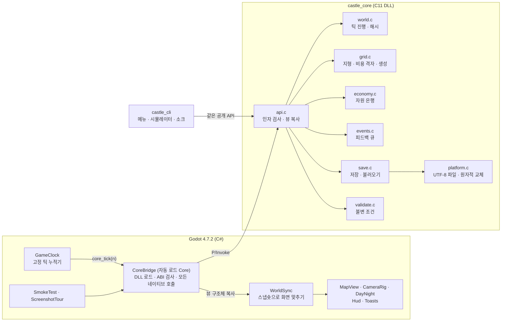

# 구조 (ARCHITECTURE)

> 원칙: **C 는 마을에 대한 진실을 가진다. Godot 은 공간과 감각을 맡는다.**

## 그림



## 누가 무엇을 가지는가

| C 코어 (`castle_core`) | Godot (C#) |
| --- | --- |
| **저장되는 모든 상태**: 주민, 건물, 자원과 장부, 지도(지형·점유·이동 비용), 계절·날씨, 연구, 시장 가격, 위협 일정, 등급, 난수 상태 | **공간과 실시간의 모든 것**: 움직이는 유닛의 연속 위치, 길찾기(`AStarGrid2D`), 적 유닛과 전투 계산, 투사체, 카메라, 입력, 그림, 애니메이션, 조명, 파티클, 소리, UI, 메뉴 |
| **모든 규칙과 수치**: 생산, 소비, 임금, 저장 한도, 기분, 병, 이주, 배치 검사, 비용, 연구 효과, 사건 일정, 습격 구성, 등급 조건, 승패, 적·탑의 능력치 | **물리적 사실을 C 에 보고**: 주민 도착 / 길 없음, 건물·주민 피해, 적 처치, 약탈, 습격 끝 |
| 위 모든 것의 저장·불러오기 | 설정 파일만 (음량, 해상도, UI 배율) |

마일스톤 1 에서 실제로 있는 것: 지도(지형, 비용 격자), 시계, 난수, 자원 은행, 피드백 이벤트, 저장·불러오기, 불변 조건 검사.

## 경계 규칙 (안정성의 핵심)

1. Godot 은 게임 상태를 직접 바꾸지 않습니다. 모든 변경은 C 명령이나 보고를 거치고, C 가 매번 검사합니다.
2. **불투명 핸들, 평평한 뷰**: Godot 은 월드를 `IntPtr` 하나로만 들고 있습니다. 데이터는 `int32_t` 필드와 고정 크기 UTF-8 배열로 된 뷰 구조체에 복사되어 건너옵니다. C 메모리를 가리키는 포인터는 보관하지 않습니다.
3. **이벤트가 아니라 스냅숏으로 맞추기**: 매 틱 뒤 `WorldSync` 가 요약(나중에는 주민·건물 뷰 전체)을 복사해 화면을 맞춥니다. 이벤트 큐는 소리·알림에만 씁니다. 이벤트를 놓쳐도 어긋나지 않습니다.
4. **id 는 다시 쓰지 않습니다** (단조 증가 32비트 카운터, 저장됨). — 마일스톤 2
5. **코어는 언어를 모릅니다**: C 는 이벤트 코드와 숫자만 냅니다. 한국어 문장은 Godot 의 `Strings.cs` 와 CLI 의 `format.c` 가 만듭니다.
6. **고정 틱, 결정적 코어**: 1틱 = 게임 속 10분 (하루 144틱). Godot 은 실제 시간 × 배속을 모아 `core_tick(world, n)` 을 정수로 부릅니다. 난수(PCG32)는 월드 안에 있고 저장됩니다. 같은 시드 + 같은 명령 순서 → 같은 상태 (테스트 `world_same_seed_same_state`).
7. **한 스레드**: 코어는 Godot 메인 스레드에서만 부릅니다. 에디터(`[Tool]`)는 DLL 을 로드하지 않습니다 (`Engine.IsEditorHint()` 검사).
8. **시작할 때 ABI 검사**: `core_abi_version()` 과 C 가 알려 주는 구조체 크기를 `Marshal.SizeOf<T>()` 와 비교하고, 다르면 분명한 메시지를 띄우고 시작하지 않습니다.
9. **우아하게 실패**: 모든 C API 함수는 인자를 검사하고 오류 코드를 돌려줍니다. Godot 은 `CoreBridge` 한 곳에서 모든 호출을 감싸 `CoreResult` 로 바꿉니다.

## 주민 핸드셰이크 (마일스톤 2 에서 구현)

1. C 가 매 틱 주민마다 상태 기계(상태 번호로 고르는 함수 포인터 표)를 돌립니다: `SLEEP`, `GO_WORK`, `WORKING`, `EAT`, `IDLE`, `SEEK_HEALING`, `FLEE`, `GUARD_POST`, `LEAVING`.
2. 주민은 **의도**(상태, 목표 건물 또는 칸, `intentRev`)를 내보냅니다. 의도가 바뀔 때마다 `intentRev` 가 1 오릅니다.
3. Godot 이 길을 찾아 걷게 하고, 도착하면 `core_villager_arrived(world, id, intentRev)` 를 부릅니다. C 는 오래된 rev 는 무시합니다.
4. 길이 없으면 `core_villager_unreachable(...)`. C 가 다른 할 일을 고르고 "길이 막혔습니다" 알림을 냅니다.
5. 생산은 `WORKING` 일 때만 쌓입니다. 그래서 **걷는 시간 = 일 못 하는 시간**이고, 집·일터 배치와 도로가 중요해집니다.
6. 불러온 뒤 주민은 목표 건물이나 집에서 다시 나타납니다.

## 습격 핸드셰이크 (마일스톤 4 에서 구현)

1. C 가 위협을 미리 정하고 `THREAT_SCHEDULED`(종류, 방향, 도착 시각, 세기)를 냅니다. UI 는 남은 시간을 보여 줍니다.
2. 도착하면 C 가 습격(id, 적 종류 × 수)을 만듭니다. 적 능력치는 C 의 정의 파일에서 옵니다.
3. Godot 이 지도 가장자리에 유닛을 만들고 전투를 돌립니다.
4. Godot 이 피해, 처치, 약탈, 습격 끝을 보고합니다.
5. C 가 체력, 죽음, 무너진 건물, 보상(마물 → 마정석), 안전 기분을 처리합니다.
6. 전투는 물리 엔진 없이 단순하게: `AStarGrid2D` 경로, 성벽은 비싼 칸, 탑·경비병은 사거리 안 가장 가까운 적을 쿨다운마다 공격.
7. 습격 중에는 저장할 수 없습니다.

## 시간의 흐름 (마일스톤 1)

```
매 프레임:  GameClock._Process(delta)
             누적 += delta × 배속
             n = floor(누적 / 0.5초)   (0.5초 = 1배속의 한 틱, C 의 real_ms_per_tick)
             n > 0 이면 Core.Tick(n) → core_tick(world, n)
                          → Ticked 신호 → WorldSync.Reconcile()
                                           ├ core_get_summary → HUD
                                           ├ cost_grid_rev 확인 (길찾기 다시 만들기, M2)
                                           └ core_poll_event 반복 → 알림
             DayNight 는 매 프레임 (분 + 틱 진행률) 로 색을 부드럽게 계산
```

## 공개 API (`core/include/castle_core.h`)

| 분류 | 함수 | 하는 일 |
| --- | --- | --- |
| 버전 | `core_abi_version()` | ABI 번호 (지금 1) |
| | `core_get_struct_sizes(out, size)` | 뷰 구조체 크기 (C# 이 비교) |
| | `core_get_config(out)` | 하루 틱 수, 실제 시간, 밤 시각 등 고정값 |
| | `core_result_name(code)` | 오류 코드의 영어 이름 (로그용) |
| 수명 | `core_create(params, &world)` | 새 게임 (성채 이름, 시드, 난이도) |
| | `core_destroy(world)` | 해제 (NULL 이어도 됨) |
| 시간 | `core_tick(world, n)` | n 틱 진행 (1 ≤ n ≤ 1440) |
| 읽기 | `core_get_summary(world, out)` | 날짜·시각·자원·성채 위치 등 |
| | `core_get_map_size(world, &w, &h)` | 지도 크기 |
| | `core_copy_terrain(world, buf, cap)` | 지형 격자 복사 |
| | `core_copy_cost_grid(world, buf, cap, &rev)` | 이동 비용 격자 복사 + 수정 번호 |
| 피드백 | `core_poll_event(world, out)` | 이벤트 하나 꺼내기 (있으면 1) |
| 저장 | `core_save(world, path)` | 원자적 저장 + `.bak` |
| | `core_load(path, &world, &line)` | 불러오기, 실패하면 문제 줄 번호 |
| 디버그 | `core_validate(world)` | 불변 조건 위반 개수 |
| | `core_state_hash(world, &hash)` | 저장되는 상태 전체의 해시 |

다음 마일스톤에서 더해질 것: 배치 미리보기(`core_can_place`), 명령(건설, 철거, 수리, 배치, 거래, 연구, 승급), 보고(도착, 길 없음, 피해, 처치, 약탈, 습격 끝), 주민·건물·정의·위협 뷰 복사.

## 결과 코드

| 코드 | 값 | 뜻 |
| --- | --- | --- |
| `CORE_OK` | 0 | 성공 |
| `CORE_ERR_NULL_ARG` | -1 | 꼭 필요한 포인터가 NULL |
| `CORE_ERR_INVALID_ARG` | -2 | 값의 범위가 잘못됨 |
| `CORE_ERR_OUT_OF_MEMORY` | -3 | 할당 실패 (기존 상태는 그대로) |
| `CORE_ERR_BUFFER_TOO_SMALL` | -4 | 호출한 쪽 버퍼가 작음 |
| `CORE_ERR_FILE_OPEN` | -5 | 파일을 열 수 없음 |
| `CORE_ERR_FILE_IO` | -6 | 읽기·쓰기·교체 실패 |
| `CORE_ERR_FORMAT` | -7 | 세이브 파일 내용이 잘못됨 |
| `CORE_ERR_VERSION` | -8 | 세이브 파일 버전이 다름 |
| `CORE_ERR_STRUCT_SIZE` | -9 | ABI 검사: 구조체 크기가 다름 |
