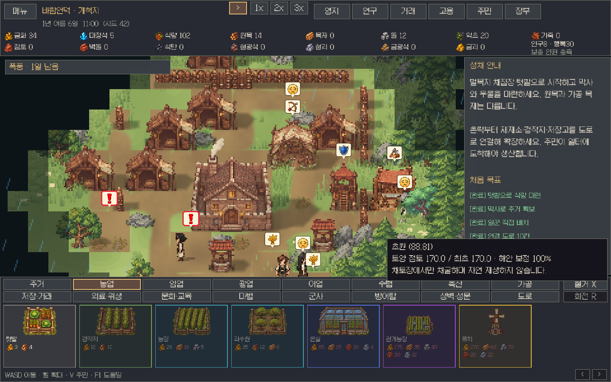
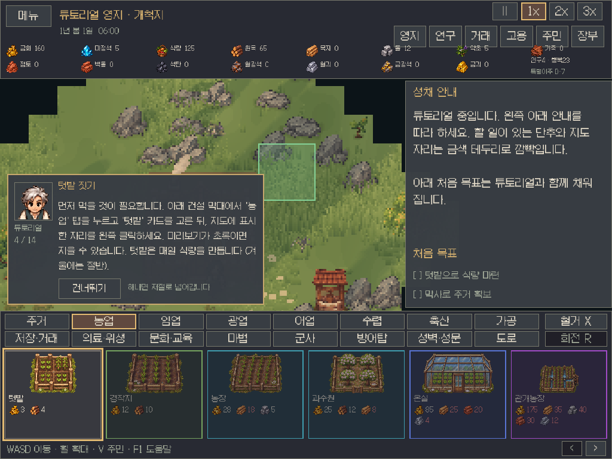

# 실제 게임의 GPU 픽셀 풍경

승인한 2D 조명과 자연 풍경을 실제 게임의 기본 렌더 경로에 연결합니다. 별도 실험실을 실행하지 않아도 새 게임·튜토리얼·이어하기·불러오기와 제목 배경에 같은 그림자·풀·물·잎·연기를 사용합니다. 게임 규칙과 저장 형식은 그대로 유지합니다.

## 실행

Windows 배포본을 모두 푼 뒤 `start-game.cmd` 또는 `castle_game.exe`를 실행합니다. 실행 파일 옆의 `assets`와 `data` 폴더를 함께 둡니다. OpenGL 4.3 이상을 지원하는 드라이버가 필요하며 Windows 11·RTX 4060을 주 대상으로 합니다. 관리자 권한이나 추가 런타임 설치는 필요하지 않습니다.

메인 화면의 새 게임이나 튜토리얼로 시작합니다. 휠은 1~6의 정수 배율, 가운데 버튼은 지도 이동입니다. 낮·밤은 실제 게임 시각을 따릅니다. 실험실의 숫자·방향키·효과 전환 단축키는 게임에 추가하지 않으며 기존 배속·이동 조작을 유지합니다.



설정의 효과 줄이기는 잎·풀·연기 비용을 줄입니다. 그림자·재료 조명·물가는 기본 경로에 남습니다. 픽셀 크기는 같은 논리 격자를 유지하고 한글 UI는 화면 해상도로 그립니다.

## 적용 범위

- 원화와 알파를 유지한 2D 법선 조명, 태양과 건물의 따뜻한 지역 광원.
- 상자·박공 지붕·굴뚝의 큰 그림자와 실제 원화 밑선에서 자른 둥근 그림자. 바위·나무·인물의 부유 타원을 제거합니다.
- 이어지는 초지·해안·돌길, 다섯 종류의 풀 군집, 흔들리는 잎과 풀, 흐르는 물결·거품, 네 배로 커진 굴뚝 연기.
- 실제 월드 씨앗·도로 등급·계절·탐험 상태·건물 가동 상태를 사용합니다. 미탐험 지형·물체가 보이는 화면을 바꾸지 않게 합니다.
- 건설 입력·물체 선택·툴팁·체력 표시·튜토리얼 지도 강조가 렌더러와 같은 정수 카메라를 사용합니다.
- 새 게임·불러오기·제목 배경 생성 시 움직임을 명시적으로 초기화합니다. 같은 시드·메모리 주소를 다시 사용해도 이전 세계의 연기를 넘기지 않습니다.

비교 장면과 게임은 `castle_gpu` 정적 라이브러리 하나를 연결합니다. GLSL은 빌드할 때 실행 파일에 포함하므로 배포본에 셰이더 소스 경로가 필요하지 않습니다. 원화 알파에서 만든 접촉 자료도 GPU에서 캐시하고 일반 프레임에 CPU로 읽지 않습니다.

## 검사 방법

`check-graphics.cmd`는 별도의 검사 저장 폴더에서 새 게임·튜토리얼·이어하기·불러오기→제목을 세 번 반복하고 `graphics-check.log`에 기록합니다. 소유한 GPU 자원이 종료 후 0개인지 검사합니다. 실제 플레이 저장을 불러오거나 덮어쓰지 않습니다.

```sh
castle_game --gpu-transitions 3 --no-audio --width 800 --height 600
castle_game --screenshot title.png --screen title --width 1024 --height 768 --no-audio
castle_game --screenshot tutorial.png --screen tutorial --no-audio
castle_game --screenshot game.png --screen game --no-audio
castle_game --smoke-test --days 20 --seed 42
```

소스의 MSVC 전체 검사:

```powershell
cmake --preset windows-msvc -DCASTLE_WERROR=ON -DCASTLE_GPU_TESTS=ON
cmake --build --preset windows-msvc
ctest --preset windows-msvc --output-on-failure
```

## 통합 검사 기록

Linux Release의 `CASTLE_WERROR=ON` 전체 286검사를 통과했습니다. 아트 재생성·재현성, GPU 검사 6개, 실제 원화 밑선·반전·조명 30조합과 같은 세계를 다시 열 때 연기 그림이 원래 상태로 돌아오는 회귀 검사를 포함합니다. 같은 씨앗·시각을 다시 연 연기 화면의 차이는 0화소입니다.

설치 자료만 둔 한글·공백 경로의 실행본을 `/tmp`에서 실행했습니다. 800×600·1024×768·1440×900·1920×1080에서 제목·튜토리얼 건설 단계·게임, 합계 12화면을 촬영했습니다. 설치된 런타임 원화 420개는 원본과 바이트가 일치합니다.



ASan·UBSan의 메뉴 반복은 3회·72프레임을 완료했고 소유 GPU 자원은 반복 중 같은 크기, 종료 뒤 0개였습니다. Mesa GLX 드라이버의 481개·108,124바이트 수명 잔류분은 `libGLX_mesa.so.0` 스택에만 적용한 필터로 분리했습니다. 전체 프로세스의 잔류 메모리가 0바이트라는 뜻은 아닙니다. 로컬 원문은 `build/reports/lighting-prototype/integration-*`에 둡니다.

## 검수 경계

모든 원화 방향·동작의 수작업 법선과 숨은 접촉 깊이를 완성한 상태는 아닙니다. 여섯 보정 표본 이외에는 기존 그림에서 유도한 법선과 종류별 근사를 사용합니다. 게임은 화면 가까운 지역 광원 네 개를 선택하며 광원별 압축 목록은 후속 최적화입니다.

로컬 Windows 호환성 빌드는 MinGW의 `CASTLE_WERROR=ON` 전체 타깃으로 확인했습니다. MSVC 빌드·테스트는 별도 CI 기록을 따르며 교차 빌드로 대신하지 않습니다. Linux 소프트웨어 OpenGL의 기능 검사를 실제 RTX 성능으로 기록하지 않습니다. 실제 RTX 4060 측정·30분 하드웨어 실행은 후속 확인 항목입니다. 원화·폰트·라이브러리 권리는 함께 배포하는 `CREDITS.md`, `assets/licenses`, `licenses`에 있습니다.
