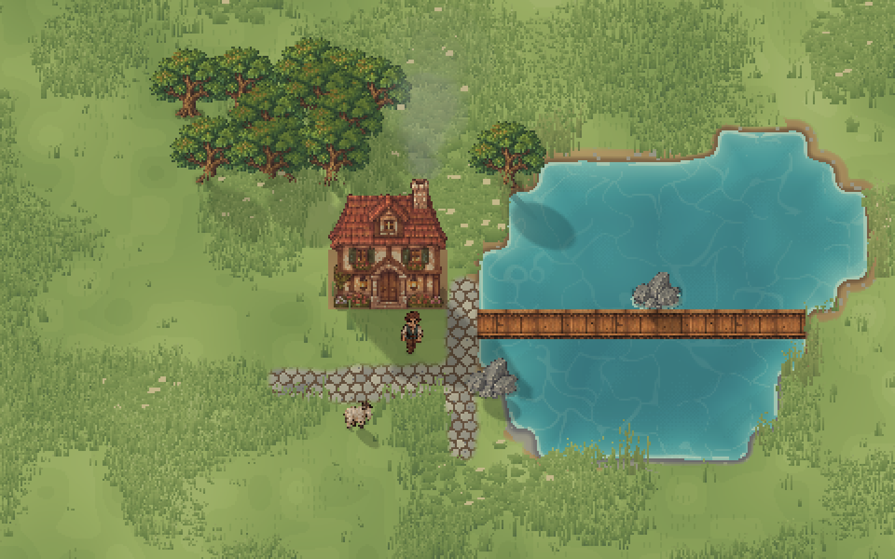
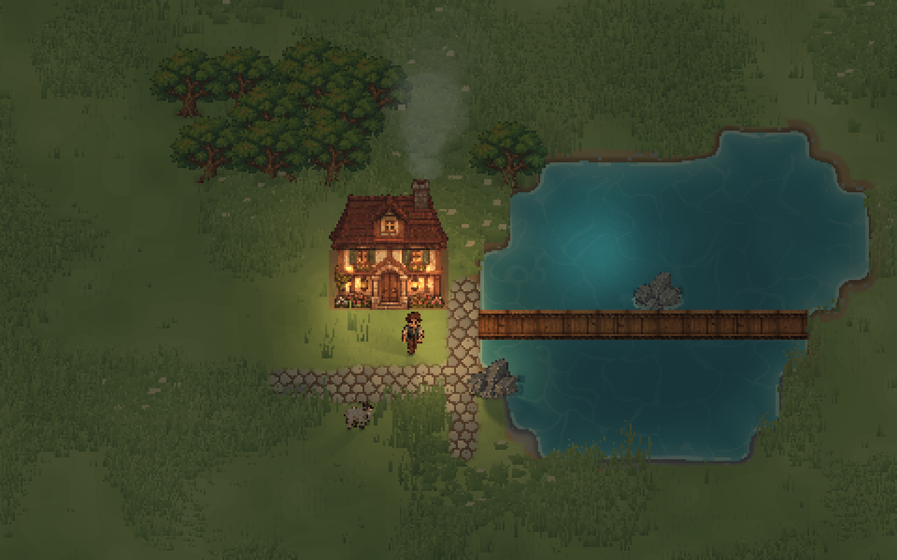

# 자연 풍경 첫 구현과 검증

기존 2D 원화를 유지한 채 공통 픽셀, 연속 초지·해안·포석, 흔들리는 식물·물·큰 연기, 실제 알파에 맞춘 그림자 앞선을 공용 OpenGL 4.3 렌더러에 구현했습니다. 실험실과 실제 게임이 같은 코드를 사용합니다. [전체 계획](PLAN_NATURAL_SCENERY.md)과 [아트 방향](SCENERY_ART_DIRECTION.md)의 첫 실행 단위입니다.

실제 게임 실행본의 적용·조작·회귀 검사는 [그래픽 통합](GRAPHICS_INTEGRATION.md)에 기록합니다. 별도 실험실 없이 `castle_game`으로 실행합니다.



## 실행

Windows 배포본은 압축을 푼 뒤 `demo.cmd`를 실행합니다. `castle_gpu_lab.exe`와 `assets` 폴더를 함께 둡니다. 기본 장면은 `natural-slice`, 씨앗은 314159, 표시 배율은 3배입니다.

```sh
build/linux-release/bin/castle_gpu_lab --scene natural-slice --pixel-scale 3
build/linux-release/bin/castle_gpu_lab --check-natural
```

휠로 1~6배 확대, 가운데 버튼으로 이동, 1/2로 낮과 밤을 전환합니다. 방향키는 태양 방향·높이, 오른쪽 버튼은 이동 횃불입니다. S/G/L/W/M은 그림자·풀·잎·물·연기를 전환하고, Tab은 최종·원화·법선·햇빛 그림자 화면을 순환합니다. H로 안내를 숨깁니다.

```sh
castle_gpu_lab --scene natural-slice --width 1920 --height 1080 --time 11 --frames 8 --capture day.png
castle_gpu_lab --scene natural-slice --night --frames 8 --capture night.png
castle_gpu_lab --scene reference
```

촬영 파일은 기본적으로 정수 확대와 여백까지 포함합니다. `--capture-logical`은 확대 전 화면을 저장합니다. `--seed`로 같은 좌표의 식물·재료 분포를 재현합니다.

## 구현한 범위

| 항목 | 현재 동작 |
|---|---|
| 공통 픽셀 | 세계 1단위가 논리 1픽셀입니다. 알베도·법선·높이·소유 번호·그림자·풀·물·연기·안개·세계 오버레이를 같은 버퍼 크기로 그리고 마지막에 정수 확대합니다. 한글 HUD는 화면 해상도에 둡니다. |
| 카메라·입력 | 화면 여백·고정한 원점을 렌더링과 마우스 역변환이 공유합니다. 제목 배경의 확대도 정수입니다. |
| 접촉 | 실제 제출한 원화 프레임의 알파 0.5 경계에서 접촉 후보를 GPU로 추출합니다. 반전과 실제 표시 크기를 따릅니다. 인물의 들린 발은 가장 아래 지지점에서 떨어져 있으면 제외합니다. |
| 큰 그림자 | 아래 2세계 단위는 접촉 거리장 기둥, 위는 상자·지붕·타원 근사입니다. 둥근 체적도 실제 원화의 아래 윤곽을 세운 면으로 앞쪽을 잘라 밑선 아래에 독립된 타원이 남지 않습니다. 수관은 같은 절단면을 쓰되 지면 기둥과 접지 음영을 만들지 않습니다. [절단 검수](SHADOW_CONTACT.md)에 원인·비교·재현 방법을 기록했습니다. |
| 지형 | 128단위 청크와 32단위 여유 영역에서 물·길·바위의 부호 거리와 군집을 계산합니다. 곡선의 접선을 이어 모서리를 둥글게 하고 월드 씨앗으로 경계를 흔듭니다. |
| 해안 | 마른 가장자리·젖은 흙·모래·자갈·바위·얕은 물을 이어 붙입니다. 모래·돌·젖은 초지 성격이 큰 군집으로 바뀝니다. 다리 접속 칸의 흔들림은 막습니다. |
| 포석·다리 | 포석은 월드 좌표의 어긋난 줄과 공유 셀 경계를 사용합니다. 모르타르·깨짐·마모를 섞고 흙길·돌길·왕도 등급, 기존 목조 다리와 점토 표지는 보존합니다. 등급 경계도 섞으며 게임 칸마다 무늬를 다시 시작하지 않습니다. |
| 풀 | 짧은 풀 3~6, 보통 풀 6~13, 키 큰 풀 11~18, 넓은 잎·꽃 5~11, 갈대 14~24단위입니다. 보통 풀의 제작 범위는 기존 2.8~6.6의 두 배인 5.6~13.2이며 표시할 때 정수로 고정합니다. |
| 풀 배치·바람 | 빈 곳과 빽빽한 곳을 큰 군집으로 만들고 아래 20%를 고정합니다. 바람과 가까운 인물에 반응합니다. 한도 초과 시 씨앗 우선순위 히스토그램·누적 합으로 골라 실행 스레드 순서에 영향받지 않습니다. 최대 16,384덩어리이며 밀도 변화에는 작은 히스테리시스를 둡니다. |
| 물 | 24·61·137단위 흐름과 왜곡한 망상 무늬, 수심 색, 실제 해안·바위 접촉의 포말을 사용합니다. 무늬와 흐름은 지형 칸을 넘어 이어집니다. |
| 연기 | 같은 나이의 입자 지름을 4배로 키우고 상승도 넓혔습니다. 고정 UV 마스크를 확대하지 않고 같은 논리 픽셀에서 둥근 윤곽을 다시 평가합니다. 입자 수는 최대 2,048개로 유지합니다. |
| 연기 합성 | 한 입자의 최고 불투명도는 0.125, 겹친 연기는 0.375로 제한합니다. 높이 가림을 적용한 별도 논리 레이어에서 합성합니다. |
| 색 | 초지·흙·나무·돌·지붕·물·연기·회반죽에 [제작 팔레트](../art/recipes/scenery_direction.json)를 적용했습니다. 인물의 고유 색은 유지하고 메뉴의 기본 패널·글자도 공통색에 맞췄습니다. |
| 탐험 상태 | 미탐험 칸의 실제 재료를 지형 거리장에 넘기지 않습니다. 알려진 쪽의 경계값으로 연장하고, 미탐험 물체가 보이는 땅에 그림자를 던지지 않게 합니다. |



## 자료와 자원

`contacts.txt`의 종류별 아래 표본 범위·숨은 깊이를 `tools/art/gpu_scenery.c`가 `contact_policy.png`로 발행합니다. 양쪽 원장과 요청·권리 기록을 갱신했습니다. 접촉 거리장은 등록된 원화와 이 규약에서 실행 중 생성하는 기술 자료입니다. 신규 외부 그림이나 셰이더 코드를 복제하지 않았습니다.

| 자료 | 상한 |
|---|---|
| 지형 거리장·길 등급 | 192×192 RGBA16F 페이지 64개, 약 18MiB |
| 접촉 거리장 | 4096×4096 R8, 512프레임 후보, 16MiB |
| 그림자 절단 앞선 | 256×512 RGBA16F, 접촉 프레임과 캐시를 공유, 1MiB |
| 풀 | 16,384개, 후보 수·그룹 누적 합·우선순위 자료는 지도 크기에 비례 |
| 연기 | 64굴뚝 × 32입자, 별도 논리 해상도 합성 |

지형은 바뀐 칸과 여유 영역에 겹치는 페이지만 다시 굽습니다. 상주 한도 밖은 같은 식으로 계산해 경계를 빠뜨리지 않습니다. 접촉은 프레임별로 캐시합니다. 일반 프레임에서 입자·풀·거리장을 CPU로 읽어오지 않습니다. 읽기는 명시적인 검사에서만 합니다. 새 월드나 되돌린 시각에서는 이전 굴뚝 입자를 지웁니다.

## 검사 기록

Linux Release의 `CASTLE_WERROR=ON` 전체 285검사와 아트 재생성·재현성 검사를 통과했습니다. 이후 변경은 GPU 검사와 촬영·자원 반복 검사로 다시 확인합니다. 실행 로그와 촬영 파일은 `build/reports/lighting-prototype/natural-*`에 둡니다.

최종 장면 검사는 접촉 앞선 987열의 최대 오차 0.25픽셀, 청크 이동의 지면 표본 135,680개에서 차이 0개, 강제로 제한한 풀 512개의 씨앗 우선순위 일치를 확인했습니다. 정수 확대의 표시 오류와 미탐험 자료 변경에 따른 알려진 화면 변화도 0개입니다. 원장에는 재생성 입력 336개와 런타임 자료 420개가 있습니다. 라이브 창에서도 낮·밤 전환과 2↔3배 휠 확대를 확인했습니다.

`--check-natural`은 다음을 검사합니다.

- 800×600, 1024×768, 1440×900, 1920×1080, 1180×812의 실제 표시 픽셀과 논리 화면 일치 및 30개 배율·좌표 왕복.
- 원화 아래 윤곽과 접촉 거리장의 오차 1픽셀 이내, 근사 접지 음영의 재덮기 없음.
- 풀 다섯 종류, 보통 풀 6~13, 정수 뿌리, 물·길 제외, 동일 시각의 배치 일치.
- 제한 512개에서 씨앗 우선순위에 맞는 선택과 반복 렌더 일치.
- 이웃 청크 여유 영역 일치, 128단위 카메라 이동의 지면 색 일치, 숨은 재료 변경이 알려진 화면을 바꾸지 않음.
- 같은 연기의 4배 지름에서 면적이 약 16배가 되는지, 겹침 불투명도 제한이 실제 합성 결과에 적용되는지.

제목 화면 다섯 크기와 `--screen tutorial|game`, `--smoke-test`, 메뉴→새 게임·튜토리얼·계속·불러오기→메뉴의 반복도 확인했습니다. ASan/UBSan의 3회·72프레임 반복에서 소유한 GPU 자원은 같은 크기를 유지하고 종료 시 0개였습니다. Mesa GLX의 481개·108,124바이트 수명 잔류분은 `mesa-lsan.supp`로 범위를 제한해 분리하며, 전체 프로세스가 0바이트를 남긴다고 기록하지 않습니다.

`--check-shadow-cut`은 바위·인물·나무 각각의 좌우 반전과 다섯 조명 조건, 총 30개 조합을 검사합니다. 정면 햇빛에서는 열마다 실제 표시 알파의 밑선 아래로 새는 큰 그림자가 없어야 합니다. 뒤쪽 햇빛에서는 그림자가 남고 밑선과 붙어 있어야 합니다. 점광원과 비스듬한 햇빛은 이웃 열로 이동하는 그림자를 허용하되 원화 전체 밑선 아래의 부유 타원을 검사합니다. Windows의 `shadow-demo.cmd`로 같은 원화를 확대해 볼 수 있습니다.

## 다음 검수와 측정

자동 접촉은 후보입니다. 가려진 지지 깊이는 명시한 재료별 근사이고, 모든 건물 방향·주민 동작·나무 종류를 수동 검수한 결과는 아닙니다. 예외 프로필의 [작성 형식](../art/recipes/contact_profile.schema.json)과 [원화 목록](art/scenery_asset_inventory.json)을 유지합니다. 여섯 조명 표본 이외의 원화는 기존 그림과 일반 표면 법선을 사용합니다.

현재 그림자 목록은 정확한 초과 대체 경로를 유지합니다. 광원별 압축 목록, 전체 원화의 예외 접촉·명암 검수, 계절별 세부 조정은 전체 계획의 후속 항목입니다.

이전 [RTX 4060 기준값](benchmarks/RTX4060_BASELINE.md)은 이전 화면 맞춤 실험의 측정입니다. 새 버퍼는 논리 해상도가 다르므로 그 값으로 새 장면의 성능 통과를 선언하지 않습니다. 보고서에는 표시·논리 해상도, 씨앗, 원래 GPU 제출 프레임 번호, 단계별 원시 표본을 기록합니다. 긴 실행은 최근 6,000개를 60프레임 간격으로 보관하고 실행 전체의 자원 증가를 확인합니다. 기준·효과·기준 스크립트의 별도 프로세스 차이는 근사값으로 표시합니다.

Windows 실행 파일은 MinGW 경고 오류 빌드로 만듭니다. 이번 외형의 실제 RTX 4060 측정, 30분 하드웨어 실행, MSVC 전체 빌드·테스트와 같은 프로세스에서의 차분 측정은 아직 별도 확인이 필요합니다. 이 구현은 첫 플레이 가능한 검수본이며 전체 그래픽 교체의 최종 배포 판정은 아닙니다.
