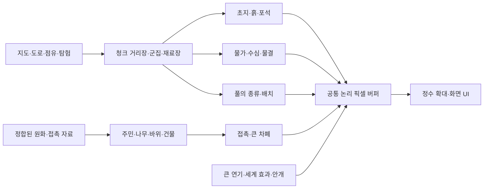

# 자연스럽고 통일된 픽셀 풍경 구현 계획

상태: 첫 공용 렌더러 구현과 자연 풍경 장면을 만들었습니다. 현재 동작·검사·후속 항목은 [구현 기록](NATURAL_SCENERY.md)에 구분합니다. 아래 수치와 단계는 전체 그래픽 교체의 제작 정본이며 모든 단계의 완료 선언은 아닙니다.

정본은 [아트 방향](SCENERY_ART_DIRECTION.md), [기계 판독 제작 수치](../art/recipes/scenery_direction.json), [접촉 프로필 계약](../art/recipes/contact_profile.schema.json), [RTX 4060 기준값](benchmarks/RTX4060_BASELINE.md)입니다. 기존 GPU 기반 설명은 [GPU_SCENERY.md](GPU_SCENERY.md)에 남깁니다.

## 1. 요청과 완료 조건

| 요청 | 구현 결정 | 완료 조건 |
|---|---|---|
| 모든 효과의 픽셀 크기 통일 | 세계 1단위=1논리 픽셀, 공통 세계 합성 뒤 정수 확대 | 바닥·스프라이트·그림자·풀·물·연기·안개가 같은 화소 경계와 카메라 원점을 사용 |
| 실제 원화에 맞는 그림자 밑선 | 원화와 정합한 여러 접촉 영역+정확한 하단, 근사한 상단 | 뿌리·발·바위 밑선 오차 1논리 픽셀 이내, 반전·동작 프레임에도 유지 |
| 자연스러운 지형 경계와 물가 | 월드 거리장·공통 군집·불규칙한 재료 전환 | 지도 칸·청크 이음매와 반복 줄무늬가 보이지 않고 모래·젖은 흙·얕은 물이 이어짐 |
| 풀 높이 두 배와 다양성 | 일반 풀 5.6~13.2단위, 다섯 종류와 연속 군집 | 키·밀도·종류가 덩어리별로 달라지고 뿌리·주민 가림 관계가 맞음 |
| 연기 네 배 | 입자 지름·높이 4배, 면적 16배, 최대 2,048개 유지 | 동일한 정규화 나이에서 크기 비교 통과, 화소 크기와 굴뚝 위치 유지 |
| 타일이 느껴지지 않는 풀 | 연속적인 초지 바탕+절차 생성 식생층 | 같은 바닥 타일 위에 장식만 추가한 모습에서 벗어나 30초·3분 영상에서도 군집이 자연스러움 |
| 연결되는 돌길 | 월드 도로 연결과 공유된 돌 이음 자료 | 길·교차점·모서리가 이어지고 모르타르는 읽히며 16단위 반복 격자는 드러나지 않음 |
| 자연스러운 물 | 수역 전체의 수심·흐름·동적 법선·거품 | 바위·기슭을 따르는 움직임과 끊어진 거품, 카메라 이동에도 이어지는 무늬 |
| 밝고 조금 거친 마법의 중세 | 재료별 팔레트·그늘 온도·마모·강조 면적 규약 | 자연·건물·주민·UI가 한 색 체계에 속하고 재료와 읽힘이 유지 |

## 2. 실제 기준과 현재 코드의 차이

사용자가 제공한 12사례에서 1080p GPU p95는 기본 낮 0.8991ms, 밀집 낮 4.9203ms, 밀집 밤 3.1662ms입니다. 밀집 낮의 벽시계 p95는 5.3819ms입니다. 이 값은 기존 실험실의 결과이며 전체 게임의 프레임 성능이나 새 방향의 통과값으로 사용하지 않습니다.

| 현재 위치 | 확인한 구현 | 바꿀 부분 |
|---|---|---|
| `gpu.c`의 화면 타깃 | 표시 해상도 크기의 MRT·조명·연기 | 공통 논리 타깃과 정수 표시를 분리 |
| `geometry.vs` | 잎 이동을 세계 1단위로 반올림 | 모든 세계 레이어와 같은 표본·원점 계약 사용 |
| `grass.cs` | 칸마다 최대 여섯 후보, 높이 2.8~6.6, 같은 마스크의 변형 | 연속 군집·다섯 종류·두 배 높이·보이는 후보만 생성 |
| `fields.cs`의 물가 | 주변 3×3칸의 사각형까지 거리 | 이어지는 거리장과 실제 해안 재료·바위 마스크 |
| `geometry.fs`의 바닥 | 기존 셀 그림에 큰 색 변화 | 자연 지형을 공통 월드 재료장으로 합성하고 칸의 그림 경계를 제거 |
| `shadows.glsl`·`gpu_bridge.c` | 타원·상자 접지, 발자국 크기에서 추정 | 실제 접촉 마스크·발자국과 하단 차폐 |
| `smoke.vs`·`smoke.fs` | 나이에 따라 커지는 16화소 마스크 | 네 배 크기의 윤곽을 공통 격자에서 재평가하고 합성 면적 관리 |
| `bins.cs` | 광원 범위를 합친 128개 목록과 정확한 전체 검사 | 광원별·고정/이동별 압축 목록, 초과 원인 계측 |

기준 밀집 장면에는 실제 풀 9,970개·연기 2,048개가 있습니다. 낮 55개·밤 47개 타일에서 정확한 전체 검사로 넘어갑니다. 다음 시각 기능을 확대하기 전에 이 목록 비용과 연기의 겹침 비용을 관리합니다. 네 사례에서 음수인 p95 차이는 별도 실행의 측정 변동으로 다룹니다.

## 3. 공통 픽셀과 좌표 계약

`P=1 world unit`, 지도 칸 `16P`, 기준 주민 높이 `24P`, 기본 표시 `N=3`입니다. 현재 카메라 확대 1~6과 맞는 정수 배율을 사용합니다. 렌더 원점은 `P`에 고정하고 모든 세계 레이어가 공유합니다. 내부 카메라·바람·입자 위치는 부동소수점으로 유지합니다.

표시 뷰포트는 `floor(screenWidth/N) × floor(screenHeight/N)`의 논리 버퍼를 정수 확대해 가운데 둡니다. 여분 화소는 화면 여백으로 처리합니다. 예를 들어 1920×1080은 640×360, 1440×900은 480×300, 1024×768은 341×256+가로 여백 1개, 800×600은 266×200+가로 여백 2개입니다. 마우스→세계 변환에도 같은 뷰포트와 원점을 사용합니다.

`CastleGpuFrame.width/height`와 벤치마크의 기존 `width/height`는 표시 크기로 유지합니다. 새 `pixel_scale`과 내부 논리 크기·뷰포트를 추가하고, 셰이더의 뷰포트는 논리 크기, 세계→논리 배율은 `1/P`로 통일합니다. 원화의 세계 크기는 바꾸지 않습니다. 현재 제목 배경의 1.7~3 실수 확대도 가까운 정수 배율로 고정합니다.

알베도·알파·법선·높이·재질·소유 번호·그림자·물·풀·연기·세계 효과와 안개는 같은 논리 픽셀 중심을 사용합니다. 일반 그림과 회전 사망 동작, 투사체·물보라·선택 윤곽 등 현재의 세계 오버레이도 이 경로로 옮깁니다. 메뉴·HUD 글자는 마지막 화면 레이어에 두어 한글의 읽힘을 유지합니다.

현재 `gpu_bridge`의 화면 크기 오버레이를 세계용 논리 오버레이와 화면 UI로 구분합니다. 논리 오버레이는 `offset=(0,0)`, `target=고정한 렌더 원점`, `zoom=1/P`인 카메라를 사용합니다. 화면 좌표의 역변환도 `world=renderOrigin+(screen-viewportOrigin)*P/N`으로 공통 함수에 모읍니다. 반올림 전 카메라로 입력을 계산해 생기는 한 화소 차이를 피합니다. 마지막 정수 확대 뒤에 같은 세계를 다시 원래 화면 해상도로 그리는 경로가 남지 않게 검사합니다.

스프라이트·접촉·차폐체·굴뚝은 같은 인스턴스의 표시 기준점과 변환을 공유합니다. 표시 기준점의 고정식은 C/GLSL 양쪽에서 `floor(value/P+0.5)*P`입니다. 풀의 뿌리를 고정한 뒤에는 그 최종 위치로 물·도로 제외를 검사합니다. 상태를 적분할 때의 부동소수점 정밀도는 유지합니다.

기존 사영은 `screen=(worldX, worldY-0.9*height)`입니다. 법선은 월드 +X,+Y,+Z, 높이는 월드 단위입니다. 그림자가 사용하는 기준과 스프라이트의 기준점을 같이 정의합니다. 픽셀화는 마지막 색 화면에만 덧씌우는 필터로 만들지 않습니다. 잘못된 높이·소유 번호·가림은 그 방식으로 고쳐지지 않기 때문입니다.

원본 그림은 보존하고 목표 격자에서 중요 특징과 실루엣을 검수합니다. 법선을 평균낼 때는 벡터를 다시 정규화하고 작은 면의 방향 변화가 전부 사라지는지 확인합니다. 알파는 모든 관련 버퍼에 같은 기준을 적용합니다. 상태·재료·소유 번호 자료는 감마 변환이나 색 혼합을 적용하지 않습니다.

## 4. 지형을 잇는 공통 자료

지도의 칸은 이동·건설·자원·안개 판정의 원본으로 유지합니다. 렌더러는 그 자료에서 **연속적인 지면 재료장**을 만듭니다. 자연의 색과 무늬는 칸별 UV에서 시작하지 않고 월드 좌표에서 평가합니다.

| 자료 | 형식·단위 | 갱신 |
|---|---|---|
| 지형·도로·점유·탐험 원본 | 공개 상태의 복사본 | 실제 상태 변경 때 |
| 수역·길 부호 거리 | `RG16F`, 월드 단위, 범위 ±32 | 바뀐 청크와 이웃의 여유 영역 |
| 재료 종류·예외 표식 | 작은 정수 자료 | 원본 또는 제작 프로필 변경 때 |
| 군집·밀도·색 분포 | 결정적인 월드 씨앗과 여러 공간 크기 | 생성 또는 캐시 갱신 때 |
| 바람·파동·연기 | GPU 필드·SSBO | 장식 시간으로 갱신 |
| 고정 그림자 | 태양/지역 광원별 청크 캐시 | 차폐 위치·형태·광원 위치가 바뀔 때 |

청크는 현재와 같은 128세계 단위, 여유 영역은 32단위입니다. 공통 격자에서 코어 128×128, 여유 포함 192×192표본이 됩니다. 이웃도 같은 월드 씨앗과 좌표를 사용하고 코어 영역만 발행합니다. 여유 영역은 최대 거리 32를 덮도록 정합니다. 캐시 상주 한도 64페이지와 새 필드·접촉 자료 64MiB 한도를 두고 사용량을 기록합니다.

기슭의 시각적 흔들림은 최대 2세계 단위, 전환 폭은 3~8단위입니다. 항구·다리 접속점은 흔들지 않습니다. 원본 칸 중심의 땅/물 부호를 보존하고 이동·건설 판정을 바꾸지 않습니다. 안개는 탐험 자료를 먼저 적용해 부드러운 경계가 미탐험 정보를 드러내지 않게 합니다.

수역 칸 중심에서 이어지는 등고선을 재구성하고 반경 2~6단위의 곡선 모서리를 만듭니다. 사각 계단 윤곽을 유지한 채 흐리기만 하지 않습니다. 곡선과 흔들림을 합친 경계 이동은 최대 4단위, 좁은 물길의 보이는 폭은 최소 4단위로 제한합니다. 모호한 대각선 접속은 원본의 연결 관계를 보존하는 규칙으로 결정합니다. 경계 가까운 거리 값은 보정해 캐시의 근사 오차가 기슭을 끊지 않게 합니다.

한 픽셀의 재료 무게 합은 1이며 최대 세 종류만 섞습니다. 재료 혼합은 지면 패스 안에서 끝내고 알베도·정규화한 법선·높이를 한 번 기록합니다. 노멀·소유 번호가 알파 혼합으로 잘못되는 문제를 다시 만들지 않습니다.

## 5. 실제 접촉부를 따르는 그림자

### 제작 자료

프레임마다 원화 해시, 소스 사각형, 기준점, 실제 표시 크기, 보이는 접촉 앞선, 닫힌 지면 발자국, 정확한 하단 높이, 상단 근사를 기록합니다. 여러 발·뿌리·돌덩어리는 분리된 영역을 가질 수 있습니다. 형식은 [contact_profile.schema.json](../art/recipes/contact_profile.schema.json)에 고정했습니다.

`source_rect`는 아틀라스 화소, `anchor_px`와 `visible_front_px`는 그 사각형 안의 로컬 화소입니다. `footprint_world`는 지면 기준점에서의 월드 +X,+Y 좌표이고 마지막 점에서 첫 점으로 닫습니다. 화면 앞선의 기대 위치는 원화 표시 변환으로 구하고, 지면 다각형의 앞선은 같은 사영으로 대조합니다. 반전·회전·동작 프레임에는 동일한 변환을 적용합니다.

알파 0.5 이상인 원화와 낮은 높이 영역에서 후보를 얻되, 나무의 잎·바위의 돌출부·문간 장식까지 지면으로 해석하지 않습니다. 보이는 접촉은 제작 표시로 확정하고 보이지 않는 뒤쪽 깊이는 명시적으로 작성합니다. `candidate`와 `reviewed`를 구분하며 실행 완료의 적용률에는 검수한 자료만 셉니다.

### GPU 처리

접촉 마스크와 부호 거리장을 작은 아틀라스에 굽습니다. 같은 모양인 프레임은 해시로 공유할 수 있습니다. 차폐체 하단 2세계 단위는 이 발자국을 사용하고, 위는 현재의 타원체·상자/지붕·캡슐·선체 근사와 연결합니다. 넓은 위쪽 그림자가 존재하더라도 뿌리·발 밑의 주변광 접촉부는 실제 모양을 따릅니다.

하단의 점유는 `footprintSdf(x,y)<=0`과 `0<=z<=exactLowerHeight`의 교집합입니다. 상단 근사는 이 하단 높이 아래를 잘라 중복된 둥근 밑면이 정확한 발자국을 덮지 않게 합니다. 광선의 하단 슬래브 진입/이탈 구간만 접촉 마스크에서 격자 DDA로 검사하고, 그 밖의 구간은 기존 해석적 교차를 사용합니다. 넓은 범위 제외 뒤의 작은 접촉 마스크에만 이 검사를 적용합니다.

접촉 주변광 음영은 1~3픽셀 범위의 단계화한 거리 감쇠로 만듭니다. 큰 그림자는 광원별 직접광을 가리고 주변광·다른 빛을 남깁니다. 같은 물체·소속 광원 제외, 수신 높이, 낮은 태양의 긴 그림자 규칙을 보존합니다. 전체 스프라이트 실루엣을 늘려 그림자로 쓰지 않습니다.

우선 집·나무 뿌리·바위·양발 주민의 네 종류를 고정합니다. 이어 나무 종류/성장·방향별 집·동물 발·선체와 교각, 실제 걷기 프레임을 확장합니다. 접촉 표시가 누락된 프레임은 진단에서 표시하고 아트 완료로 숨기지 않습니다.

## 6. 자연 지형·물가·돌길

초지는 48~128단위의 큰 군집과 8~24단위의 작은 군집을 섞어 바닥 색·낮은 식생·큰 풀 종류를 함께 정합니다. 노이즈 색만 더해 반복된 잔디 원화가 계속 줄지어 보이는 결과를 완료로 인정하지 않습니다. 원본 그림에서 얻은 재료색과 작은 질감 표본은 이 연속 장의 재료로 사용합니다.

물가는 건조한 땅, 젖은 흙, 자갈/모래, 얕은 물의 순서로 연결합니다. 돌 해안·모래 해안·늪의 프로필을 구분합니다. 폭·재료·작은 굴곡은 월드에 고정하며 기슭 전체를 동일한 흰 띠로 둘러싸지 않습니다. 작은 섬·좁은 물길·오목한 물가·다리 끝·항구가 첫 검수에 포함됩니다.

돌길은 기존 도로 연결을 읽고 그 접선과 경계를 기준으로 포석을 배열합니다. 돌 크기는 폭 3~7, 길이 4~10픽셀, 모르타르는 약 1픽셀입니다. 이웃 돌은 정렬한 월드 모서리 키를 공유해 선과 끝점이 이어집니다. 깨짐 1~2픽셀과 물기·마모·이끼의 큰 분포로 규칙성을 완화합니다. 건설 단위의 정사각형 이음은 숨기고 실제 돌의 이음은 읽히게 합니다.

포석 후보와 모서리 그래프는 도로 칸마다 새로 시작하지 않습니다. 세계에 고정한 줄맞춤 후보를 조금 흔들어 만들고 길의 연결된 영역으로 자릅니다. 교차점도 같은 그래프를 사용하며, 별도 방향의 줄을 만날 경우 연결 띠의 모서리를 먼저 공유합니다. 같은 모서리를 양쪽 돌이 서로 다른 난수로 만들지 않습니다.

건물의 벽·문·기초와 돌길의 배열은 정돈된 형태를 유지합니다. 땅과 만나는 가장자리 1~3픽셀에 흙·낮은 풀·마모를 넣습니다. 자연의 윤곽을 부드럽게 만드는 규칙으로 벽 전체를 굽히지 않습니다.

## 7. 풀·물·연기의 구현 규약

### 풀

기존 높이 2.8~6.6에 정확히 2를 곱한 5.6~13.2단위를 일반 들풀 기준으로 둡니다. 표시 전까지 이 값을 유지하고 공통 격자에서 약 6~13픽셀로 평가합니다. 낮은 풀 3~6, 키 큰 잎풀 11~18, 넓은 잎/꽃 5~11, 물가 풀 14~24픽셀을 군집 자료로 섞습니다.

GPU가 보이는 청크의 고정 후보를 월드 씨앗으로 평가합니다. 한 칸마다 같은 수를 채우지 않고 청크 경계를 넘는 밀도·종류장을 사용합니다. 한 묶음 3~7잎, 잎 폭 1~2픽셀, 뿌리 간격 2~5단위가 기준입니다. 목표 12,000묶음, 상한 16,384묶음과 우선순위 기반 LOD를 먼저 유지합니다. 큰 색 덩어리와 낮은 식생이 빈 간격을 메웁니다.

용량 제한은 실행 순서가 빠른 GPU 스레드부터 채우는 방식으로 처리하지 않습니다. 고정 씨앗의 우선순위·군집별 배정량과 결정적인 count/scan/fill로 선택해 상한에 닿아도 풀이 프레임마다 바뀌지 않게 합니다. 최대 밀도 입력과 같은 정지 프레임을 반복해 결과가 일치하는지도 검사합니다.

뿌리 아래 20%는 고정하고 끝으로 갈수록 큰 바람과 개별 흔들림을 섞습니다. 가까운 주민 주변의 풀은 국소적으로 눕히며, 가림 순서와 선택한 주민의 위치를 읽을 수 있게 합니다. 밀도 LOD에는 이력 구간을 둬 천천히 이동할 때 군집이 반짝이지 않게 합니다. 뿌리의 지면 접촉은 LOD가 바뀌어도 같은 자리입니다.

### 물

월드 크기 24·61·137단위의 서로 다른 흐름을 섞고 수심·거리장으로 그 세기와 방향을 조절합니다. 동적 법선은 같은 높이장에서 얻습니다. 흐름·거품·수중 빛무늬는 실제 수역과 잠긴 바위·교각을 따릅니다. 원본 물 타일의 반복이나 열마다 다른 색 띠를 바탕에 남기지 않습니다.

거품과 빛무늬의 두께는 1~2논리 픽셀입니다. 경계의 꺾임은 거리장의 기울기와 월드에 고정한 낮은 주파수 굴곡으로 풀고, 하얀 외곽선이 프레임마다 점멸하지 않게 합니다. 계산 필드는 필요하면 성긴 간격에서 보간하되, 보이는 색·윤곽·그림자는 모두 공통 격자에서 평가합니다.

### 연기

`smoke.vs`의 지름과 높이에 4를 곱합니다. 입자 수·방출 수를 네 배로 늘리는 뜻이 아닙니다. 동일한 씨앗·정규화 나이·시야에서 원래 지름 대비 4배를 공통 픽셀 반올림 오차 안에서 확인합니다. 16화소 UV 양자화는 제거하고 마스크의 거리/밀도 윤곽을 세계 픽셀에서 다시 평가합니다.

면적이 16배가 되는 점을 먼저 비용으로 잡습니다. 방출점과 덮는 범위의 제외, 작은 실제 윤곽, 빈 마스크 건너뛰기 순서로 처리합니다. 64굴뚝·2,048입자에서 겹침 비용이 목표를 넘으면 입자 타일 목록을 이용한 밀도 합성으로 옮깁니다. 이 경우에도 장면 높이와 각 입자의 가림을 적용하고 보이는 연기를 낮은 해상도로 흐리지 않습니다.

굴뚝의 시작점은 고정하고 원본 건물의 방향별 위치를 검수합니다. 커진 덩어리는 옅은 단계 색과 제한한 최종 불투명도로 그려 건물·주민의 주요 실루엣을 유지합니다.

초깃값은 입자 최대 불투명도 0.125, 겹친 덩어리 최대 0.375, 투명도 16단계입니다. 논리 해상도의 별도 연기층에 가림을 적용해 누적하고 마지막 합성에서 덩어리 한도를 적용합니다. 크기 네 배를 유지한 채 겹친 중앙이 불투명한 회색 벽이 되는 것을 막습니다.

## 8. 단계와 파일 소유

| 단계 | 수정 중심 | 작업과 산출물 | 통과 조건 |
|---|---|---|---|
| A | `gpu.h`, `gpu.c`, `geometry.*`, `lighting.cs`, `gpu_bridge.c`, `world.c`, `ui/main_menu.c`, `lab.c` | 공통 논리 격자·정수 표시·세계 오버레이 이관·재료 팔레트. 작은 비교 장면과 진단 보기 | 다섯 크기·배율 1~6·카메라 이동에서 화소 크기와 마우스 위치 일치 |
| B | `tools/art/` 접촉 굽기, `art/sources/` 제작 프로필, `gpu.h`, `common.glsl`, `shadows.glsl`, `gpu_bridge.c` | 실제 접촉 마스크·하단 발자국·복수 지지점, 최초 네 종류 | 접촉 정합 최대 1픽셀, 이동·반전·낮은 태양·지역 광원 비교 |
| C | `bins.cs`, `cache.cs`, `shadows.glsl`, `gpu.c` | 광원별·고정/이동별 목록, GPU count/scan/fill 압축 목록과 한도 계측 | 기준 장면의 전체 검사 전환 0 목표, 강제 초과에서도 누락 0 |
| D | 새 `terrain_fields.cs`, `terrain.vs/fs`, `gpu.c`, `gpu_bridge.c`, `world.c` | 거리장·연속 초지·기슭·변경 청크/여유 영역 | 모든 이웃 청크 경계와 땅/물·다리·항구의 판정 유지 |
| E | 새 포석 재료, `terrain.fs`, 제작 재료 자료 | 이어지는 포석·교차점·마모·일관된 노멀 | 줄·끝점·모서리·이웃 칸이 이어지고 16단위 반복 줄이 없음 |
| F | `grass.cs`, 풀 전용 그리기, `fields.cs`, 군집 자료 | 다섯 종류·두 배 높이·풀 군집·국소 눕힘·LOD | 기준 높이 두 배, 고정 뿌리, 반복·깜빡임과 발 가림 검사 |
| G | 수면 계산·수면 재료·기슭 자료 | 연속 수심·흐름·거품·바위 주변 무늬 | 30초/3분 재생·기슭 이동·역방향 카메라·정지 재현 |
| H | `particles.cs`, `smoke.*`, 필요 시 연기 타일 합성 | 네 배 연기·같은 화소 크기·범위 제외 | 크기 4배·입자 한도·높이 가림·밀집 합성 비용 |
| I | `tools/art/`, `art/`, `game/assets/`, `ui/widgets.c`, 매니페스트·권리 | 방향·성장·동작·계절·재료별 전체 적용표·UI 의미 색과 공통 재료색 연결 | 누락·잘못된 기준점 0, 한글 대비·재생성/재현성 및 권리 추적 통과 |
| J | `lab.c`, 벤치마크·캡처 도구, 실제 게임 연결점 | A/B/A 측정·전체 검사·30분 실행·Windows 묶음 | 아래 성능·시각·수명·MSVC 조건을 기록하고 통과 |

공통 파일 `gpu.h`, `gpu.c`, `common.glsl`, `gpu_bridge.c`의 자료 계약을 단계 A/B에서 먼저 고정합니다. 이후 기능별 변경은 해당 재료·컴퓨트 파일에 모읍니다. 게임 규칙·세이브 스키마·튜토리얼 함수의 변경은 이 시각 작업의 의존 조건으로 두지 않습니다.

첫 구현 단위는 A+B와 작은 D입니다. 집 한 채·바위·뿌리·걷는 주민, 키 다른 초지 두 군집, 연못 한쪽 기슭과 포석 교차점을 같은 공통 격자로 완성합니다. 이를 기준으로 F/G/H를 넓힙니다. 자료형과 팔레트가 정해지기 전에 모든 원화를 다시 생성하지 않습니다.

첫 장면의 실제 자산 ID·크기·위치·씨앗·카메라·조명·진단 보기·단언은 [natural_scenery_slice.json](fixtures/natural_scenery_slice.json)에 준비했습니다. 전체 확장에 쓸 373개 세계 텍스처의 해시·선언 크기·역할 검토 목록은 [scenery_asset_inventory.json](art/scenery_asset_inventory.json)에 있습니다. 이 목록은 검수를 끝낸 프레임 수가 아닙니다.

## 9. 런타임 자료 계약

| 자료형 | 필수 내용 | 저장 위치 |
|---|---|---|
| `PixelGrid` | 논리/표시 크기, 정수 배율, 뷰포트, 원점, P | 렌더러 문맥 |
| `TerrainPage` | 청크 키·원본 변경 번호·코어/여유 범위·자료 위치 | 렌더러의 한도 있는 캐시 |
| `MaterialProfile` | 팔레트·거칠기·노멀 강도·혼합 우선순위·계절 조정 | 아트 파이프라인이 만든 자료 |
| `GroundContactProfile` | 소스/기준점·복수 앞선/발자국·검수 상태·마스크 인덱스 | 제작 JSON→검사한 아틀라스/메타데이터 |
| `GrassPatch` | 월드 씨앗·종류 분포·높이·밀도·바람 반응 | GPU 후보/간접 명령 |
| `ShadowTileList` | 광원·고정/이동 구분·오프셋·개수·용량 상태 | GPU 압축 목록 |
| `SmokeTileList` | 겹치는 입자와 범위, 장면 높이 참조 | 필요 시 GPU 합성 자료 |

SSBO는 16바이트 정렬을 유지하고 C의 `_Static_assert`와 셰이더의 같은 레이아웃을 검사합니다. 자료형을 확장할 때 Sprite/Caster의 크기와 모든 제출 지점을 한 변경으로 수정합니다. 출처 프레임과 접촉 인덱스는 같은 객체/소스 선택에서 정하고, 좌우 반전·방향별 프레임도 같이 넘깁니다.

스프라이트에는 접촉/재료 프로필의 인덱스를, 차폐체에는 발자국 인덱스·로컬 변환·정확한 하단 높이를 추가합니다. `tags`의 기존 소유자·재료·보정 노멀·씨앗 의미를 덮어쓰지 않습니다. C와 GLSL에 한 개의 16바이트 정렬 메타데이터 블록을 추가하고 레이아웃 크기를 함께 갱신하는 방식으로 시작합니다.

현재 Sprite 96바이트와 Caster 64바이트는 이 방식에서 각각 112·80바이트가 됩니다. 차폐체의 기존 접촉 도메인 네 실수는 로컬 마스크의 위치·크기 변환에 재사용하고, 새 블록은 프로필 인덱스·변환 플래그·하단 높이·예비값을 담습니다. 상단 근사와 하단 마스크의 단위를 섞지 않습니다.

제작 JSON의 실행용 변환은 CMake의 JSON 처리와 기존 C 아트 도구에 연결합니다. Python 패키지를 게임 실행이나 기본 아트 재생성의 필수 의존성으로 추가하지 않습니다. 팔레트·표시 크기·마스크의 기본값은 기계 판독 규약에서 생성하고 셰이더와 C에 따로 복사해 관리하지 않습니다.

## 10. 아트 파이프라인

새 실행 원본은 `art/sources/`에 두고, 원본·굽기 레시피·법선·높이·접촉·움직임 자료의 대응표를 작성합니다. 기존 원화의 정체성·방향·기준점을 보존합니다. 사용자 참고 이미지의 그림을 실행 자산으로 가져오지 않습니다.

새 이미지 생성이 필요하면 같은 재료 규약과 공통 픽셀 목표를 프롬프트에 넣고 `art/recipes/provenance.json`에 정확한 요청을 기록합니다. 권리는 `CREDITS.md`, 제작 입력은 `art/art_manifest.json`, 실행 출력은 `game/assets/assets_manifest.json`에 등록합니다. 알베도·노멀·접촉을 각각 다른 자유 생성 결과로 맞추는 방식을 피하고 정합된 원본에서 굽습니다.

접촉의 자동 후보와 검수 결과는 구분합니다. 바닥·평면 장식에는 큰 차폐가 필요하지 않다는 역할도 명시합니다. 아틀라스의 선언 셀 수를 실제 유효 동작 프레임 수로 오해하지 않고, 소스 선택 코드와 대조한 적용표로 확인합니다.

`assets_regenerate`, `assets_reproducible`, 출처 SHA·권리·정합 검사를 완료 조건에 넣습니다. 이번 계획 JSON과 팔레트 설명 그림은 설계 자료이며 새 실행 자산으로 세지 않습니다.

## 11. 측정과 완료 검사

### 시각·공간

- 네 요구 해상도와 1180×812, 배율 1~6에서 같은 세계 화소를 확인합니다. 카메라 이동·왕복·창 크기 변경·화면 좌표 선택을 검사합니다.
- 원화 알파·접촉 앞선·지면 발자국·최종 그림자의 진단 겹침을 보여 줍니다. 최대 오차 1논리 픽셀, 분리된 발/뿌리의 틈 유지, 동작 프레임과 좌우 반전 검사입니다.
- 땅↔풀·흙↔길·땅↔물·섬·물속 바위·오목한 해안·다리 끝과 청크 모서리를 고정 씨앗으로 검사합니다. 이웃 청크가 동일한 월드 좌표에서 같은 값을 내야 합니다.
- 반복 격자 표시를 켠 진단과 최종 화면을 비교하고 30초·3분의 움직임에서 줄무늬·반복 덩어리·깜빡임을 검수합니다. 자연에서 지도 칸이 읽히지 않고 포석의 실제 이음은 읽혀야 합니다.
- 일반 풀의 같은 씨앗 높이는 정확히 두 배, 연기의 같은 정규화 나이 지름은 네 배입니다. 양쪽 모두 공통 격자 반올림 오차를 명시합니다.

### 성능·수명

공통 준비 120프레임 뒤 각 A/B/A 구간에서 60프레임을 준비하고 최소 600프레임을 측정합니다. 비동기 질의에 구간·프레임 번호를 저장해 이전 구간의 값이 섞이지 않게 합니다. 단계별 GPU p50/p95/p99, CPU 제출, 벽시계, 논리/표시 해상도, 실제 그린 수와 메모리를 기록합니다.

움직이는 객체와 효과는 같은 씨앗·시간 구간을 재생합니다. 누적 상태가 있는 입자는 GPU 안에 보관한 초기 상태로 복원해 비교하며, 정상 실행의 CPU 되읽기를 추가하지 않습니다. 준비 구간과 실제 측정 구간의 시야·가림·그린 수가 바뀌면 별도 사례로 남깁니다.

1080p의 기본/밀집 낮/밤·지역 광원 4개를 우선 측정하고 8·16개를 확장합니다. 현재 밀집 구성 100건물·500주민·200나무·약 10,000풀·64굴뚝·2,048연기를 유지하며, 새 카메라에서 제출 수와 실제 보이는 수를 함께 기록합니다. 공통 격자로 시야나 표본 수가 바뀐 결과는 기존 전체 장면 맞춤 보기와 다른 계열입니다.

일차 목표는 같은 새 표시 조건에서 추가 GPU p95 4ms 이내, 렌더러 합계 GPU p95 8ms 이내입니다. 전체 게임의 16.67ms 목표는 시뮬레이션·UI·표시를 포함해 별도로 확인합니다. 목표를 넘으면 광원 목록·성긴 계산 필드·가려진 풀·연기 타일 합성을 순서대로 조정하며 접촉 정합과 공통 픽셀 기준을 품질 저하 항목으로 쓰지 않습니다.

30분 실행과 변경 청크·창 비활성/복귀·줌·메뉴→새 게임/튜토리얼/이어하기/불러오기→메뉴 반복에서 준비 구간 이후 자원 수와 사용량이 늘지 않아야 합니다. 캐시와 입자 한도 초과도 기록하고 누락을 허용하지 않습니다.

### 빌드·회귀

`--screenshot --screen title|tutorial|game`, `--smoke-test`, 기존 GPU 계산·효과·자원·메뉴 검사를 유지합니다. 지형·접촉·공통 픽셀·연기 크기와 청크 변환의 의미 있는 GPU 검사를 추가합니다. 경고 오류 설정, 아트 재현성, 전체 CTest와 실제 Windows/MSVC 검사를 완료합니다. PR을 만들 단계에서는 최신 기준 브랜치를 작업 브랜치에 반영한 뒤 `CASTLE_WERROR=ON`으로 MSVC 빌드·전체 검사를 다시 수행합니다.

다음 진단 스위치는 구현할 인터페이스입니다: `--scene natural-slice`, `--pixel-scale 1..6`, `--check-pixel-grid`, `--check-ground-contact`, `--check-terrain-seams`, `--check-grass-layout`, `--check-smoke-scale`. 현재 배포된 실행 파일의 명령으로 안내하지 않습니다. 기존 `--time`, `--capture`, `--width/height`와 같은 경로를 사용하고 검사 장면만 따로 구현한 렌더러를 만들지 않습니다.

새 실험실의 장면 카메라는 휠로 정수 확대, 가운데 마우스 끌기로 이동합니다. 방향키의 태양 조절과 기존 효과 단축키는 유지합니다. 전체 장면을 임의 배율로 화면에 맞춘 참고 보기와 새 픽셀 검수 보기는 결과 이름·논리 크기·배율을 구분해 기록합니다.

## 12. 구현 시작 체크리스트

| 항목 | 준비 상태 |
|---|---|
| 아트 분위기와 두 참고의 해석 | 확정: 아트 방향 문서 |
| 공통 픽셀·배율·좌표·UI 범위 | 확정: P=1, 기본 N=3 |
| 재료 팔레트와 강조 비율 | 수치화: 제작 JSON와 팔레트 표 |
| 풀 2배·연기 4배의 뜻 | 선형 크기로 확정, 범위·상한 기록 |
| 접촉의 출처·좌표·복수 지지점 | JSON Schema와 제작/검수 절차 정의 |
| 지형·물가·포석의 연결 자료 | 거리장·군집·공유 모서리 계약 정의 |
| GPU 자료·파일별 변경 순서 | A~J 단계와 의존 조건 정의 |
| 하드웨어 기준 자료 | 사용자 RTX 4060 요약·해시 보관 및 검산 |
| 새 그림의 실제 검수·새 성능 측정 | 구현 후 완료 조건으로 명시 |

다음 작업의 시작점은 단계 A의 공통 세계 타깃과 재료 램프, 단계 B의 원화 접촉 프로필입니다. 이 두 기준 위에 초지·기슭·포석의 작은 장면을 완성한 뒤 같은 자료를 넓은 지도와 전체 원화 프레임으로 확장합니다.
