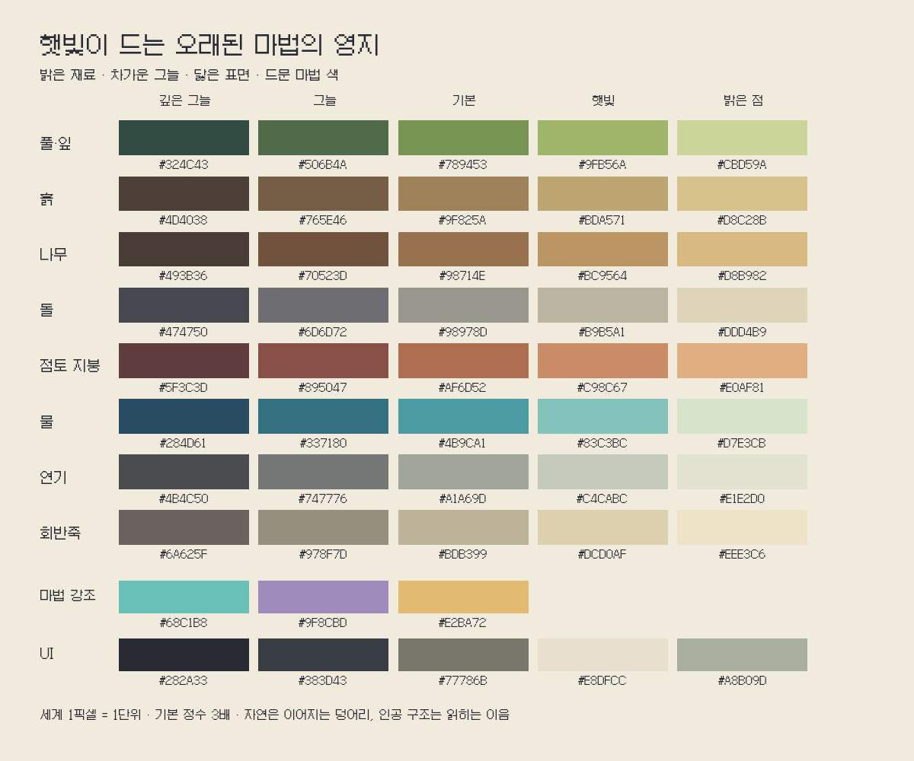

# 햇빛이 드는 오래된 마법의 영지

아트 방향은 밝은 중세의 생활감과 오래 쓴 재료, 조용한 마법입니다. 햇빛 받은 풀과 회반죽은 가볍고 따뜻하게, 그늘은 차가운 청록·회보라로 둡니다. 거친 느낌은 돌의 깨짐, 나무의 닳음, 흙과 이끼의 자리에서 만듭니다. 자연은 큰 덩어리가 이어지고, 사람이 만든 곳은 보·벽돌·포석의 질서가 읽혀야 합니다.

이 문서와 [제작 수치](../art/recipes/scenery_direction.json)는 다음 구현의 정본입니다. 첫 실행 구현과 아직 남은 검수 범위는 [구현 기록](NATURAL_SCENERY.md)에 있습니다. [구현 순서와 완료 조건](PLAN_NATURAL_SCENERY.md)에 연결합니다.

## 두 참고 이미지에서 가져올 것

| 참고 | 적용할 성질 | 이 게임에서의 표현 |
|---|---|---|
| 첫 번째의 빽빽한 풀 | 큰 군집, 키·밀도 차이, 빈 길, 작은 꽃, 잎 덩어리의 부드러운 윤곽 | 연속적인 바닥 색 분포와 여러 종류의 실제 풀 묶음. 짧은 풀 사이에 키 큰 군집이 자리하고 바람이 덩어리별로 지나감 |
| 두 번째의 물 | 얕은 곳의 투명한 색, 깊이에 따른 큰 색 변화, 바위와 기슭을 따르는 거품, 겹쳐 흐르는 무늬 | 세계 좌표에서 이어지는 수면·수심·물가 거리장. 적은 색 단계와 1~2픽셀 선으로 해석한 거품·수중 빛무늬 |

두 이미지는 사용자가 이 대화에 첨부한 시각 참고입니다. 제작자·게임명·사용 권리는 확인되지 않았으므로 실행 자산으로 복사하지 않습니다. 사용자가 보여 준 모양의 조직과 움직임을 기존 게임의 원화와 새 절차 생성 자료에 적용합니다.

## 한 가지 픽셀 기준

**세계 1단위 = 논리 픽셀 1개**로 정합니다. 현재 지도의 한 칸은 16단위이므로 16×16논리 픽셀이고, 기준 주민의 높이 24단위는 24논리 픽셀입니다. 기본 3배 표시에서 각각 48×48화면 픽셀과 높이 72화면 픽셀이 됩니다. 현재 기본 카메라 배율 3을 유지할 수 있는 기준입니다.

| 항목 | 규약 |
|---|---|
| 세계 합성 | 원화·법선·높이·재질·소유 번호·그림자·풀·물·잎·연기·세계 효과·안개를 같은 논리 버퍼에서 처리 |
| 표시 | 1~6의 정수 배율과 최근접 확대. 남는 1~수 픽셀은 대칭 여백으로 처리 |
| 카메라 | 내부 이동은 연속적으로 누적하고 표시 원점은 공통 세계 픽셀로 고정. 모든 세계 레이어에 같은 원점 사용 |
| 움직임 | 부드러운 상태 값을 GPU에서 계산한 뒤 실제 윤곽·명암은 공통 격자에서 평가 |
| 크기 변경 | 덩어리를 키우면 더 많은 논리 픽셀로 다시 그림. 원래 마스크의 한 픽셀을 큰 블록으로 확대하지 않음 |
| UI | 프레임과 아이콘의 픽셀 모듈·색을 맞추고 한글 텍스트는 별도 화면 레이어에서 가독성을 유지 |

원화는 원본을 보존하고 목표 격자에서 재표본화합니다. 중요한 눈·손·지붕선·문틀·돌의 접촉점은 작은 크기에서도 남도록 제작 단계에서 검수합니다. 작은 원본 화소를 무조건 버려 정체성을 바꾸는 방식으로 완료 처리하지 않습니다. 알베도·알파·법선·높이·접촉 자료의 기준점과 표본 위치를 일치시킵니다.

## 팔레트와 빛

각 재료는 깊은 그늘→그늘→기본→햇빛→밝은 점의 다섯 기준색을 공유합니다. 이는 모든 그림을 같은 색으로 칠하는 규칙이 아니라 재료의 명도 간격과 빛의 온도를 맞추는 기준입니다. 실제 숫자는 [scenery_direction.json](../art/recipes/scenery_direction.json)의 `palette`에 한 번만 둡니다.

기와 턱·돌 모서리·나무결·천 주름은 목표 격자에서 읽히는 1~3픽셀의 방향 변화를 남깁니다. 같은 픽셀의 원화·법선·높이를 정합해 이동광이 그 표면을 따라 반응하게 합니다. 큰 색 덩어리를 만들면서 재료가 다시 평평하게 느껴지지 않는지도 함께 검수합니다.

| 재료 | 색의 방향 | 표면을 읽히게 할 부분 |
|---|---|---|
| 풀·잎 | 깊은 청록 그늘, 올리브 중간색, 따뜻한 황록 햇빛 | 넓은 밝기 덩어리와 가는 잎 끝. 연두색 밝은 점은 일부에만 |
| 흙 | 엄버·황토·말린 진흙 | 넓은 마른 자리와 젖은 자리, 드문 자갈과 발길 |
| 나무 | 짙은 회갈색에서 꿀빛 갈색 | 보와 판재의 방향, 닳은 모서리, 적은 나뭇결 |
| 돌 | 차가운 그늘과 따뜻한 석회색 | 큰 면과 깨진 모서리, 모르타르, 지면의 이끼 |
| 지붕 | 낮은 채도의 붉은 점토와 구운 황갈색 | 읽을 수 있는 기와 줄, 조금 어긋난 끝과 작은 마모 |
| 물 | 청회색 깊이에서 탁하지 않은 청록과 옅은 민트 | 큰 수심 덩어리, 흐름, 얕은 곳의 바닥색 |
| 연기 | 회갈색 뿌리에서 연한 회녹·크림 | 둥근 군집의 겹침, 가벼운 가장자리 |
| 회반죽 | 오래된 베이지에서 따뜻한 상아색 | 넓은 벽면과 작은 균열, 그늘의 약한 보라 기운 |

피부·머리·직업 복장의 고유 색은 유지합니다. 일반 광원 아래의 명도 간격과 그늘 온도만 공통 재료 규약에 맞춥니다. 상태 경고와 선택 표시도 서로 구분되는 의미 색을 보존합니다.

UI의 본문·보조 글자는 패널에 대해 최소 4.5:1의 대비를 유지합니다. 제안한 기본색의 고정 패널 대비는 각각 약 8.27:1과 4.88:1입니다. 밝은 초지 위에서도 이 대비를 유지하도록 본문 패널의 불투명도는 최소 0.98로 시작해 합성 결과에서 다시 확인합니다.

마법의 청록·보라·호박빛은 보통 화면 면적의 약 0.5~2%에 둡니다. 룬, 작은 꽃, 마법 나무의 일부, 창과 등불이 그 역할을 나눕니다. 평범한 풀 전체가 발광하지 않도록 밝은 면적의 위계를 관리합니다. 밤에는 차가운 주변광 안에서도 흙·돌·옷의 재료색을 읽을 수 있게 합니다.

계절은 이 재료 체계 안에서 바뀝니다. 봄은 조금 신선한 황록, 여름은 올리브와 청록, 가을은 구리·마른 풀색, 겨울은 따뜻한 상아와 차가운 그늘을 중심으로 둡니다. 계절이 바뀌어도 같은 건물·바위·주민으로 알아볼 수 있어야 합니다.

## 부드러운 경계와 읽히는 픽셀

곡선은 공통 픽셀의 계단으로 표현하고, 큰 윤곽을 둥글고 불규칙하게 만듭니다. 재료가 바뀌는 자리는 3~8픽셀 폭에서 색 덩어리·풀·자갈·물기를 섞습니다. 화면 전체를 흐려서 경계를 숨기지 않습니다. 지면 색은 48~128단위의 큰 분포와 8~24단위의 작은 분포를 함께 씁니다.

자연의 무늬가 지도 16단위 경계마다 시작하거나 끝나지 않아야 합니다. 드러난 흙과 풀은 한 덩어리의 다른 부분이고, 물가의 자갈과 젖은 흙은 물과 땅을 이어 주는 재료입니다. 디더는 그늘 단계의 좁은 경계에 제한하고 넓은 면을 점무늬로 채우지 않습니다.

인공 구조는 수평·수직과 연결을 유지합니다. 벽은 곧고 보의 방향은 분명하며, 포석에는 모르타르 이음이 보입니다. 정돈된 포석 위에 크기 차이·깨짐·큰 마모 분포를 얹어 생활감을 줍니다. 자연의 경계처럼 건물 전체를 흔들거나 구부리지 않습니다.

## 풀의 최종 모습

바닥 자체가 이어지는 초지입니다. 같은 잔디 사진을 여러 칸에 반복하고 그 위에 몇 묶음을 추가하는 형태에서 벗어납니다. 큰 색 분포, 낮은 식생의 덩어리, 실제로 흔들리는 중간·키 큰 풀을 한 군집 자료에서 만듭니다.

일반 들풀의 기준 높이는 현재 2.8~6.6단위의 정확한 두 배인 5.6~13.2단위입니다. 공통 격자에 표시할 때 약 6~13픽셀이 됩니다. 밟힌 곳은 더 짧고, 키 큰 잎풀과 물가 풀은 더 높습니다. 종류와 높이 변화는 넓은 군집을 따라 일어나며 한 칸씩 바뀌지 않습니다.

풀 한 묶음에는 폭 1~2픽셀의 잎 3~7개를 둡니다. 잎의 높이·기울기·끝 모양을 조금씩 달리합니다. 같은 종류가 인접 군집에서 반복되어도 굵기와 밀도, 색의 밝은 면적이 달라야 합니다. 드문 넓은 잎·작은 꽃·말린 줄기가 모양을 바꿉니다.

뿌리는 고정하고, 큰 돌풍이 군집을 지나간 뒤 작은 움직임이 남게 합니다. 주민 가까이의 풀은 조금 눕혀 발의 위치를 읽게 합니다. 먼 군집의 밀도를 줄여도 원래 있던 자리·종류·색은 유지합니다. 높은 풀은 가려짐 순서와 얕은 자체 명암을 가져야 합니다.

## 물과 물가의 최종 모습

한 수역 전체에 큰 흐름과 수심의 분포를 둡니다. 서로 다른 크기 24·61·137단위의 무늬가 함께 움직이고, 기슭과 바위를 만나 방향이 달라집니다. 짧은 물결 영상이나 한 노이즈 타일의 반복을 시각적 바탕으로 삼지 않습니다.

땅에서 물로 갈 때 마른 흙→1~3픽셀의 젖은 자리→3~7픽셀의 자갈·모래→6~16픽셀 폭의 얕은 물→수역의 기본색을 연결합니다. 모든 기슭에 같은 폭의 흰 띠를 그리지 않고, 완만한 모래·돌 해안·늪의 재료와 기울기에 따라 다르게 보이게 합니다.

거품과 수중 빛무늬는 1~2논리 픽셀 두께의 끊긴 선과 불규칙한 작은 망으로 표현합니다. 물결은 흐르지만 물가의 기준 위치는 고정합니다. 물속 바위·교각 주변에 돌아 나오는 무늬를 두고, 원래 바위의 접촉 위치와 큰 그림자를 맞춥니다.

## 그림자가 시작하는 자리

바위의 울퉁불퉁한 밑선, 나무의 드러난 뿌리, 주민의 두 발, 동물의 발굽을 실제 원화와 같은 자리에 둡니다. 이 접촉부의 가장자리는 원화의 알파와 제작한 접촉 표시를 따라야 합니다. 그 위의 큰 차폐 형태는 현재의 둥근 범위·상자·지붕 근사를 사용할 수 있습니다.

정확한 접촉 윤곽은 작은 주변광 음영과 차폐체의 하단에 같이 사용합니다. 뿌리 아래에 큰 타원형 받침이 생기거나, 서로 떨어진 두 발 사이를 검은 바닥으로 채우지 않습니다. 위쪽 잎의 넓은 그림자와 지면에 닿은 뿌리의 어두운 음영은 역할을 나눕니다.

원화 알파만으로 보이지 않는 뒤쪽 발자국 깊이까지 알아낼 수는 없습니다. 보이는 앞쪽 접촉은 원화에서 얻고, 숨은 깊이는 작은 제작 프로필에 명시합니다. 검수 상태와 출처 해시를 남겨 추정값이 정합을 마친 자료로 섞이지 않게 합니다.

## 연기의 최종 모습

같은 나이의 기존 입자와 비교해 지름과 높이를 네 배로 키웁니다. 덮는 면적은 약 열여섯 배이므로 입자 수를 늘리지 않습니다. 큰 덩어리 안에 작은 굴곡을 공통 1픽셀 격자로 다시 그려, 연기만 큰 사각 화소로 보이지 않게 합니다.

굴뚝 입구는 고정하고 낮은 회갈색 연기가 올라가며 밝고 옅어지게 합니다. 바람이 실어 나르는 덩어리의 넓이는 커져도 지붕선과 등불·주민의 읽힘은 유지해야 합니다. 연기가 겹친 최종 불투명도를 제한하고, 다수 굴뚝의 합성 면적을 성능 검사에 포함합니다.

## 첫 검수 장면

같은 화면에 다음 요소를 놓습니다: 닳은 돌길과 네 갈래 교차점, 돌·모래·풀 해안의 연못, 물속 바위, 다리 끝, 여러 뿌리를 가진 나무, 서로 다른 높이의 풀 군집, 집과 큰 연기, 걷는 주민과 동물. 낮·흐린 낮·밤과 낮은 태양에서 같은 카메라로 비교합니다.

먼저 크게 보이는 모양의 위계, 다음으로 실제 발·뿌리·바위 밑선의 정합, 그다음에 재료 질감과 미세 움직임을 검수합니다. 정지 화면과 30초·3분 재생 양쪽에서 자연이 지도 칸으로 갈라져 보이지 않아야 합니다.
