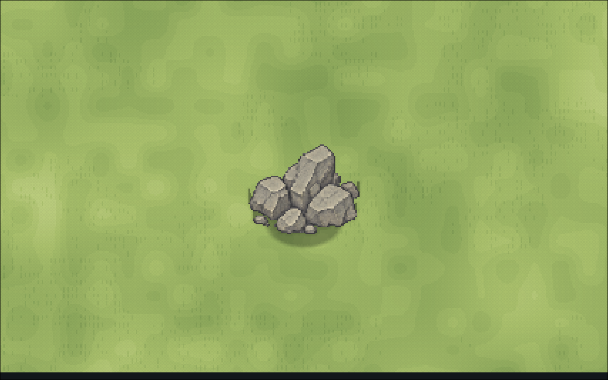
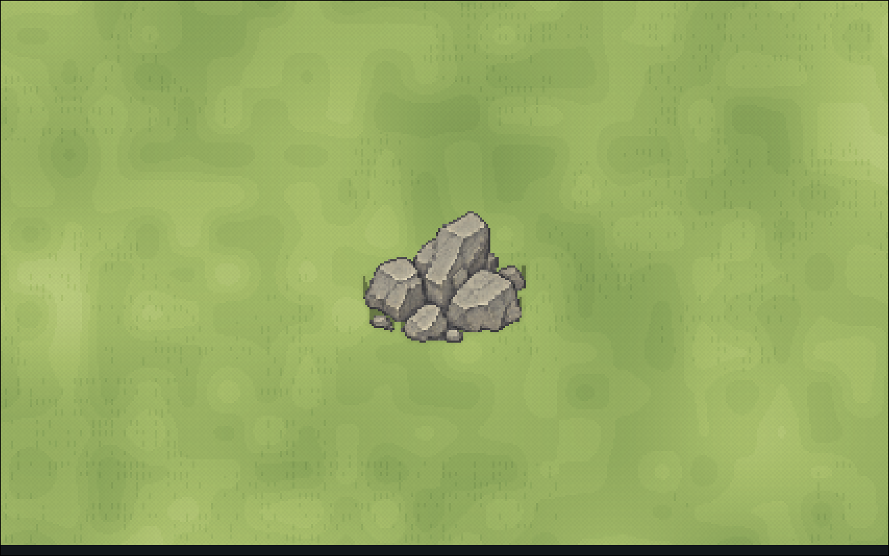
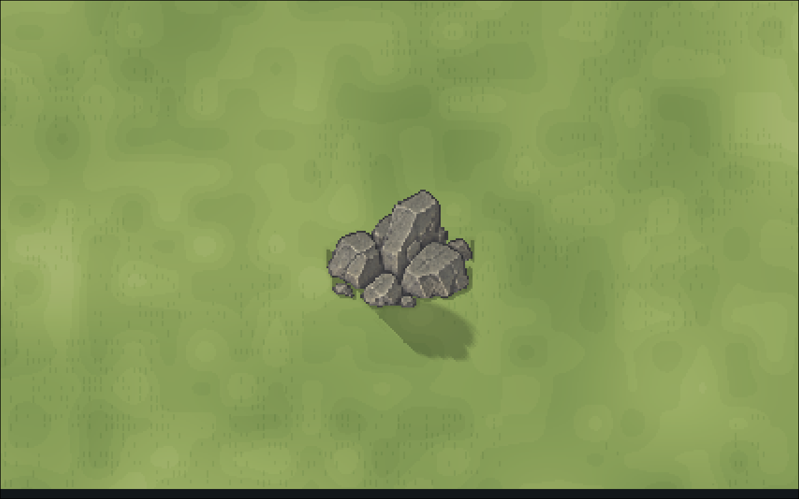

# 원화 밑선에 맞춘 둥근 그림자 절단

바위·인물·나무의 둥근 그림자는 위쪽 체적을 유지하고, 아래쪽은 실제 원화의 밑선에 맞춰 잘라 냅니다. 기존 2D 그림과 공통 논리 픽셀은 유지합니다.

## 원인과 수정

기존 하단 2세계 단위의 접촉 기둥은 실제 알파와 일치했지만 그 위의 타원체가 앞쪽으로 다시 돌출했습니다. 따라서 접촉 기둥을 맞춰도 원화 밑선 아래에 큰 타원이 따로 남았습니다.

원화 프레임의 아래 알파 경계에서 열별 앞선을 구해 256×512 RGBA16F 캐시에 보관합니다. 같은 프레임은 좌우 반전과 표시 크기를 반영해 재사용합니다. 그림자 광선과 타원체의 교차 구간을 이 앞선으로 세운 수직 절단면 안으로 제한합니다. 절단면은 지면 좌표를 사용하므로 높은 부분이 다시 원화 아래로 돌출하지 않습니다. 위쪽은 둥근 체적이며 빛을 돌리면 길이와 방향이 바뀝니다.

정확한 하단 기둥은 그대로 사용합니다. 높은 수관도 앞선으로 자르되 지면 기둥과 접지 음영은 만들지 않아 뿌리 앞에 넓은 타원이 생기지 않습니다. 상자·지붕은 기존 체적을 사용합니다. 원화 전체를 눕힌 종이 그림자는 만들지 않습니다.

추가 캐시는 최대 1MiB입니다. 원화가 처음 등록되거나 캐시에서 교체될 때만 앞선을 계산하며 일반 프레임에서 CPU로 읽지 않습니다. 기존 타원체와 만나지 않는 광선은 먼저 제외하고, 앞선 안에서 만나는 광선은 기존 결과를 바로 사용합니다. 나머지만 열별 교차 구간을 검사합니다. 절단 결과는 기존 그림자의 불투명도를 넘지 않게 제한합니다.

## 비교

같은 원화·시각·조명·카메라에서 촬영했습니다. 정면 햇빛을 사용해 밑선 아래로 새는 타원을 드러낸 비교입니다.

수정 전:



수정 후:



뒤쪽에서 빛을 주면 큰 그림자는 밑선에 붙은 채 남습니다.



## 재현과 검사

Windows 배포본의 `shadow-demo.cmd`를 실행합니다. 3/4/5는 바위·인물·나무, F는 좌우 반전, 방향키는 태양 방향·높이입니다. 2로 밤을 켜면 점광원을 검사할 수 있고 오른쪽 버튼으로 횃불을 옮깁니다. 기본 자연 장면에도 같은 렌더러를 적용합니다.

```sh
castle_gpu_lab --scene shadow-cut --pixel-scale 3 --azimuth 225 --elevation 40
castle_gpu_lab --check-shadow-cut
```

자동 검사는 실제 표시한 소유 번호 버퍼에서 원화의 밑선을 읽습니다. 바위·인물·나무, 각각의 좌우 반전, 정면·후면·두 대각선의 햇빛·정면 점광원, 총 30개 조합에서 오류 0개입니다. 정면 햇빛은 열별 밑선 아래 누출을 검사하고, 후면 햇빛은 큰 그림자가 남으며 밑선과 연결되는지 검사합니다. 비스듬한 광선이 이웃 지지점의 그림자를 옆 열로 옮기는 경우는 허용하되 전체 밑선 아래의 분리된 타원은 허용하지 않습니다.

수정 후 Linux Release의 `CASTLE_WERROR=ON` 빌드와 GPU 검사 6개를 통과했습니다. 메뉴 반복 전환·연산·자원 수명·효과·자연 풍경·밑선 절단을 포함합니다. Windows의 게임·실험실도 MinGW GCC 14와 같은 경고 오류 설정으로 빌드했습니다. MSVC나 실제 RTX 성능 검사 결과로 표시하지 않습니다.

검사에 사용하는 원화 세 장은 집중 회귀 표본입니다. 전체 원화의 가려진 깊이·종류별 접촉 후보 수동 검수와 새 RTX 4060 성능 측정은 후속 항목입니다. Linux 소프트웨어 렌더러의 실행 시간을 하드웨어 성능으로 기록하지 않습니다.
